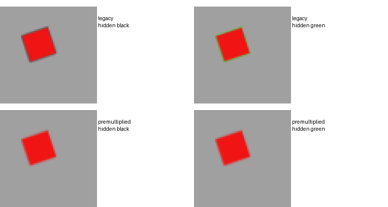
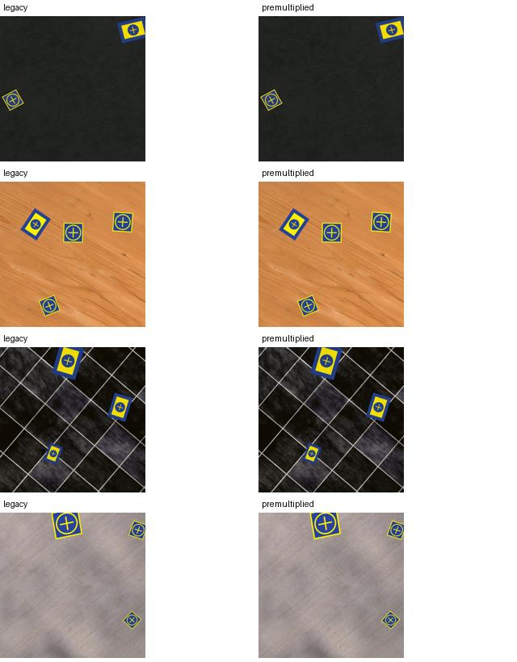

# Opt-in alpha resampling

Source `57cec2e`; Python3.13, one OpenCV thread,1280² shipped composers,20 measured paired fixtures plus2 warmups per maintained family. Treatment order alternates, each pair shares synthesis and geometry. The isolated run had no competing tests or render benchmarks. Earlier overlapping timing was discarded.

| Family | Legacy render ms | Corrected render ms | Median modeled synthesis+render cost ratio |
| --- | ---: | ---: | ---: |
| landing | 318.3 | 613.2 | 1.143 |
| manometro | 205.5 | 298.3 | 1.063 |
| landing-pad | 321.4 | 634.1 | 1.192 |

These are paired renderer costs, not measured full generation throughput: annotation polygonization, QA, encode/write and pool overhead are excluded. Float premultiplication increases render work, particularly for large foreground rasters. Background synthesis dilutes its modeled total impact. No model benefit is established.

All60 accepted pairs retain exact full/visible alpha, annotations and object rejections. The synthetic hidden-RGB fixture changes legacy edges but produces identical corrected images. Existing builtin profiles and omitted-mode rendering remain unchanged. Pre-option strict/generation hashes were frozen and matched; a pool created with pre-option code resumed without rewriting images, and cross-mode resume was refused.

Generic shape/manometro sheets and machine-readable timings are retained alongside this summary. Reproduce from repository root with `PYTHONPATH=src python scripts/study_alpha_resampling.py --output-dir outputs/experiments/alpha-study --samples 20 --warmups 2`. Raw HTML/full records remain ignored.
