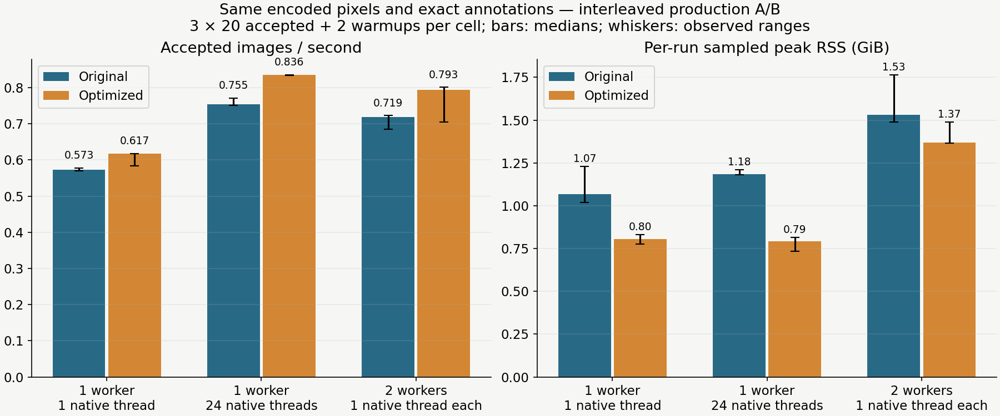
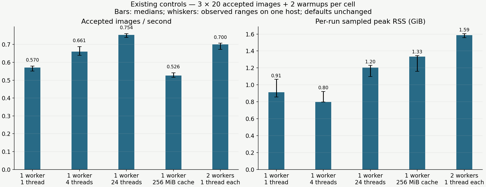
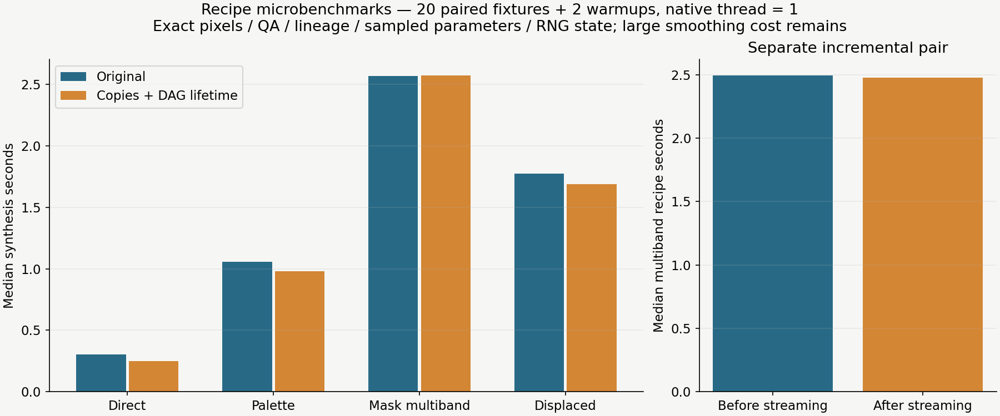
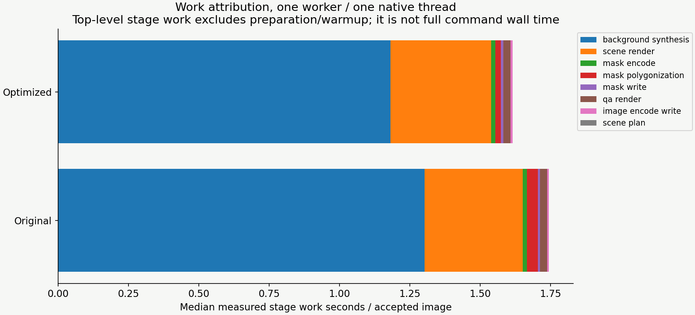
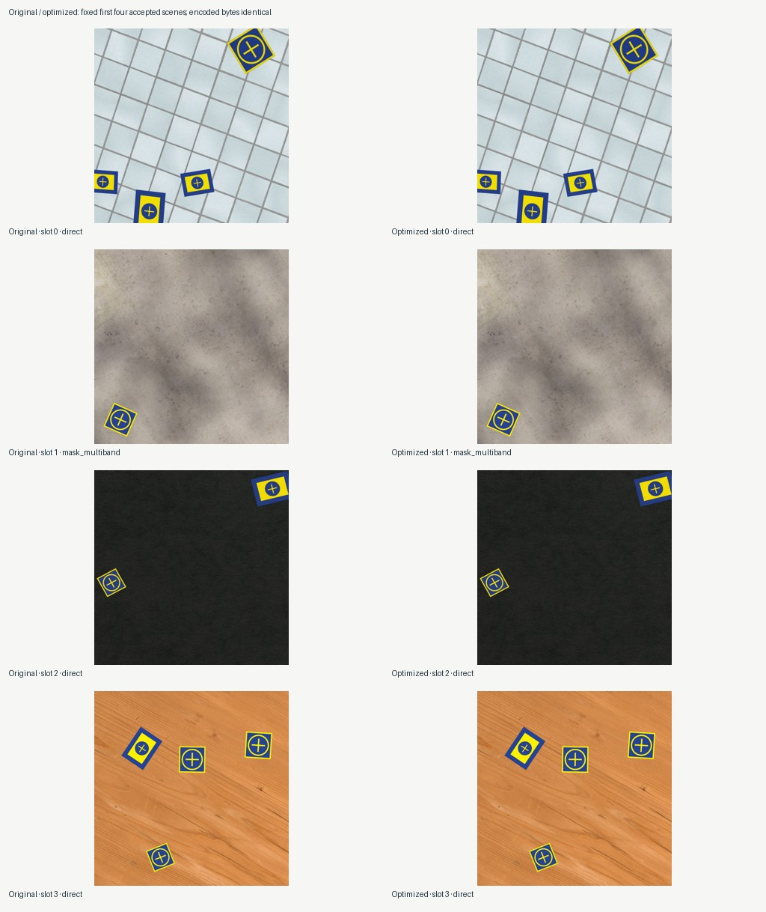

# Background performance, round two

This round removes redundant work while preserving generated content. It does not add effects or change any profile/default. Exact encoded images, geometry, annotations and mask signatures match across all production comparisons in the recorded software environment. Recipe pairs additionally preserve QA decisions/warnings, lineage, sampled parameters, graph hashes and final RNG state.

[Offline visual report](index.html) · [Compact per-repeat evidence](summary.json)

## Changes and interpretation

- Read-only float32 consumers avoid redundant copies; a per-synthesis last-use schedule releases expired DAG arrays while preserving output nodes and later asset constraints.
- Multiband blending streams the same arithmetic into coarse-to-fine reconstruction instead of retaining all Laplacian/blended pyramids. This chiefly reduces workspace; large Gaussian smoothing still dominates the recipe.
- Identical full/visible coverage reuses one polygon projection, preserving distinct annotation semantics and all quality metadata. QA rendering retains its independent projection.
- A performance-implementation revision invalidates old cost-observation matches without changing generation identity or compatible same-contract resume. Historical observations remain readable.

| Execution | Original → optimized accepted/s (median) | Paired gain, median (range) | Max sampled RSS GiB, original → optimized |
| --- | ---: | ---: | ---: |
| one-worker-one-thread | 0.573 → 0.617 | 7.7% (1.0–8.4%) | 1.23 → 0.83 |
| one-worker-24-threads | 0.755 → 0.836 | 10.5% (8.3–11.3%) | 1.21 → 0.81 |
| two-workers-one-thread | 0.719 → 0.793 | 10.8% (-1.9–15.7%) | 1.77 → 1.49 |

The two-worker range includes one slower optimized repetition. These are local observations, not guaranteed speedups. Peak traced kernel temporaries fell from 109.16 to 62.03 MiB (43.2%); that is a separate measurement from process RSS.

## Existing controls and remaining cost

The separate original-implementation study measured one native thread, four threads, the detected native default (24 here), a 256 MiB decoded cache, and two single-threaded workers. Native threads helped this host; cache did not. Each cached repetition recorded 90 hits, 30 misses and about 250 MiB retained on accepted-sample observations, yet was slower with higher sampled memory. These high-water counters do not account exhaustively for work after each worker's final accepted sample.

The five-image optimized screen also tried two workers with four/twelve native threads and queue windows of two/four/eight. It was too short and variable to justify a queue recommendation. The final A/B therefore retains the simplest useful multiworker control (two workers, one native thread each, window two). Neither that screen nor this one host promotes a default or a hardware class.

Recipe isolation (20 paired fixtures +2 warmups, 2560² canvas, one native thread) found median synthesis seconds of 0.303→0.251 for direct, 1.058→0.978 for palette, 2.567→2.574 for mask multiband, and 1.776→1.689 for displaced, before the streaming change. An independent incremental multiband pair then measured 2.496→2.479 seconds; the small total gain reflects the much larger mask smoothing cost. Do not combine those different runs into a paired speedup. The traced-allocation probe is separate from process RSS and excludes already allocated inputs.











## Reproduce

Raw pools/captured modules remain ignored under `outputs/experiments/performance-round-two/`; local composers and execution matrices remain under ignored `configs/local/performance-round-two/`. Baseline is immutable `a0d950309cc448d4eb1197cb5daaea1de53e113d`; production optimized source is `da5d55455e028d6e68733718faeeabffa85688b7`. Earlier copies/DAG recipe source is `214c9eff6d175e835814969907560f5d8a7dc068`; the incremental streaming pair starts there. Captured module hashes and generation/software identities are in the summary. Later reporting-only commits do not change the measured renderer.

Use the shipped `examples/configs/landing-pad_minimal.yaml`, with execution workers/native_threads/max_in_flight/cache overridden to 1/1/2/0 and reporting.qa_samples=4. Standard mixture and realistic-heavy appearance remain shipped settings. Create a clean detached baseline worktree; avoid concurrent tests, generation, or other benchmark load. Run each command sequentially:

```sh
# Study matrix format:
# schema_version: 1
# variants:
#   one-worker-one-thread: {workers: 1, native_threads: 1, max_in_flight: 2, decoded_cache_mb: 0}
#   one-worker-24-threads: {workers: 1, native_threads: 24, max_in_flight: 2, decoded_cache_mb: 0}
#   two-workers-one-thread: {workers: 2, native_threads: 1, max_in_flight: 2, decoded_cache_mb: 0}
# 24 is this host's measured local option, not portable guidance.
PYTHONPATH=src uv run python scripts/study_execution_controls.py \
  --source-root . --compare-source-root .worktrees/performance-round-two-baseline \
  --config configs/local/performance-round-two/baseline.yaml \
  --matrix configs/local/performance-round-two/selected.yaml \
  --samples 20 --warmups 2 --repeats 3 \
  --output-dir outputs/experiments/performance-round-two/implementation-production
PYTHONPATH=src uv run python scripts/study_background_optimizations.py \
  --config configs/local/performance-round-two/baseline.yaml \
  --baseline-ref a0d950309cc448d4eb1197cb5daaea1de53e113d \
  --samples 20 --warmups 2 --output-dir outputs/experiments/recipes-new
PYTHONPATH=src uv run python scripts/probe_multiband_allocations.py \
  --baseline-ref a0d950309cc448d4eb1197cb5daaea1de53e113d \
  --output-dir outputs/experiments/performance-round-two/allocation-probe
# Optional authoring dependency; not a generator runtime dependency.
PYTHONPATH=src uv run --with 'matplotlib>=3.10,<3.11' python scripts/report_background_performance.py \
  outputs/experiments/performance-round-two \
  --allocation-json outputs/experiments/performance-round-two/allocation-probe/summary.json \
  --output-dir outputs/experiments/performance-round-two/report
```

The retained report expects the reviewed study names/protocol. Its historical recipe panels require the **newer driver** operating on the older working directories: the driver at `214c9ef` itself required an intermediate copies-only file. From the current repository root, use the following commands on fresh output directories (the copies-only intermediate is unnecessary for these panels):

```sh
perf_repo=$(pwd)
git worktree add --detach .worktrees/performance-recipes-214 214c9eff6d175e835814969907560f5d8a7dc068
git worktree add --detach .worktrees/performance-recipes-da5 da5d55455e028d6e68733718faeeabffa85688b7
(
  cd "$perf_repo/.worktrees/performance-recipes-214"
  PYTHONPATH=src uv run python "$perf_repo/scripts/study_background_optimizations.py" \
    --config "$perf_repo/configs/local/performance-round-two/baseline.yaml" \
    --baseline-ref a0d950309cc448d4eb1197cb5daaea1de53e113d --samples 20 --warmups 2 \
    --output-dir "$perf_repo/outputs/experiments/performance-round-two/implementation-full"
)
(
  cd "$perf_repo/.worktrees/performance-recipes-da5"
  PYTHONPATH=src uv run python "$perf_repo/scripts/study_background_optimizations.py" \
    --config "$perf_repo/configs/local/performance-round-two/baseline.yaml" \
    --baseline-ref 214c9eff6d175e835814969907560f5d8a7dc068 --recipes mask_multiband \
    --samples 20 --warmups 2 \
    --output-dir "$perf_repo/outputs/experiments/performance-round-two/streamed-multiband-full"
)
```

Reproducing all retained panels requires a fresh study root; do not overwrite existing raw evidence. Reproduce `controls-full` against the original baseline using policy names `threads-one`, `threads-four`, `threads-default`, `cache-256`, `workers-two`, corresponding to workers/threads/window/cache values 1/1/2/0, 1/4/2/0, 1/24/2/0, 1/1/2/256 and 2/1/2/0. `optimized-controls-short` uses the optimized source, samples5/warmups1/repeats1 and the six policies described above. Report rendering happens after timing work.

## Method, verification and limits

Each production cell has a separate two-image warmup followed by twenty measured accepted images and four QA renders. Three rotating-order repetitions reuse the same deterministic scene set: this estimates execution variation, not sixty independent scenes. Each production repetition accepted20 images in21 attempts. Generation throughput excludes preparation and warmup; command durations include them. Observed ranges are not confidence intervals. Source checkout status and software match are verified by report authoring.

During the final A/B, minimum available host memory was 4.54 GiB; existing swap use reached 2.00 GiB. Raw per-cell observations include swap-in/out deltas and coarse host CPU samples.

One host cannot establish hardware-class guidance (#28 remains open). Sampled process-tree RSS can miss between-poll peaks; it is not a safe RAM limit. Execution RAM estimates are advisory and underpredicted observed RSS here; they were not retuned from one host. Existing host swap use does not identify a cause for timing variation. Exact image equality is a result for this locked environment, not a promise across library versions or hardware. No real-model accuracy/fidelity result follows from these measurements.

Verification: 252 deterministic tests passed on the measured implementation, including 24 exact multiband numerical cases (odd/even dimensions, float32/64 and clamped pyramid depths). Ubuntu full CLI and Windows validation passed on that renderer commit; both supported Python versions passed. A two-worker external-stop/resume smoke retained12 existing image hashes and completed32 unique samples; final pool inspection validated32 mask archives with no findings. Charts/contact sheet were visually inspected; all6 offline HTML links resolved. Browser layout inspection remains unavailable because local file URLs were blocked by browser policy; no server workaround was used.

## Next planning boundary

Further substantial speed work should compare two explicit options: (1) approximate or lower-resolution background smoothing, with a declared pixel/QA/fidelity budget and downstream failure evidence; (2) a bounded scheduling/transport redesign, with memory/backpressure, ordered commits, failure/retry, stop/resume and deterministic-output contracts. Synthesized-background reuse must separately define diversity/RNG policy; it is not a transparent extension of decoded-asset caching. These are deferred design decisions, not implementations hidden in this performance patch.

Real-reference calibration, richer physical effects/occluders, training/inference and BlenderProc remain the next realism planning round under #59/#61–64. Multi-machine evidence can proceed separately using the existing harness. See `../../PERFORMANCE_ROUND_TWO.md` for the completed scope and `../../ROADMAP.md` for broader context.
