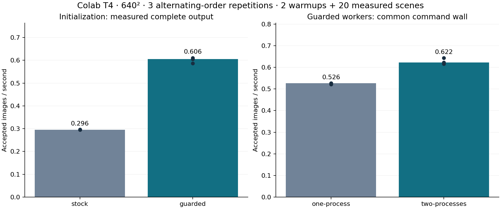
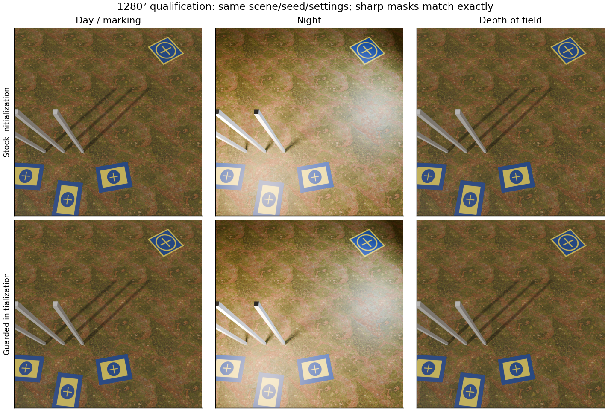

# BlenderProc execution consolidation

Date: 2026-10-26. One Linux CPU host and a Colab Tesla T4 allocation. This is optional research-harness evidence, not a core-generator GPU backend or a real-model accuracy result.

## Saved policies and portable pipeline

The [harness guide](../../../experiments/blenderproc/README.md) documents hardware probing, saved JSON policies, explicit overrides, immutable execution identities, shared resource guards and verified source/input bundles. The standalone bootstrap uses uv and BlenderProc; no Git clone is required. CPU and generic-GPU auto profiles retain stock initialization. Only the tested Colab T4 auto profiles enable guarded initialization.

| Automatic profile | Device / denoiser | Workers | CPU threads | Initialization |
|---|---|---:|---|---|
| colab-t4-small | GPU / native-gpu-oidn | 2 | 1 | guarded |
| colab-t4 | GPU / native-gpu-oidn | 1 | available, capped at 2 | guarded |
| gpu-oidn | GPU / native-gpu-oidn | 1 | available, capped at 6 | stock |
| cpu | CPU / compositor-oidn | 1 | available, capped at 6 | stock |

The small T4 rule requires the Colab environment, two available CPUs, at least 12 GiB reported VRAM and at most 409600 output pixels. Larger outputs use one worker. Unknown GPU hardware uses a conservative capability fallback; lack of advertised GPU OIDN support selects CPU or rejects an explicitly requested incompatible GPU profile. These defaults are operational choices, not established optima for all hardware. Resolution/samples/materials/camera stay explicit in the study config.

## Native GPU denoising findings

The earlier fixed-fixture probe compared one warmup + two measured images with native GPU OIDN against CPU compositor OIDN. At 640²: 11.74 → 3.97 s/image (2.95× throughput); at 1280²: 36.91 → 7.74 s/image (4.77×). A native CPU OIDN control retained the slow behavior. Two/six CPU-thread controls differed little; raw 128 was closer to the approximate raw 512 reference but slower than GPU-OIDN 32. Those are low-sample, one-fixture findings; do not multiply their speedup by the later study’s different-workload gain. OptiX denoising failed in an earlier runtime probe; native GPU OIDN is the working consolidated route.

## Renderer initialization quick win

The pinned adapter avoids assignments of already-active engine/render settings. Three alternating-order stock/guarded pairs each used two warmups and 20 measured ordinary scenes at 640², cycling the prepared reference support and three PBR grounds. Complete measured-output throughput improved by **105.0% median**, with paired gains from 98.6% to 106.3%. All 66 paired full/visible mask arrays match exactly.

Typical label cost fell from about 2.07 s to 0.40 s. The original profile identified repeated Cycles reset/free work; no geometry/annotation algorithm or full-mask semantics were weakened. Stock initialization remains available for comparison. CPU prototypes showed a small benefit and ordinary RGB variability, so CPU auto behavior was not changed.

After that change, two one-thread processes improved aggregate common-command throughput by **19.4% median** over one two-thread process (17.1–22.2% over three alternating pairs). This denominator includes startup and warmup outputs in both arms. The initialization study instead divides measured accepted outputs by their summed complete-output seconds. Per-process rates are never summed. All 66 worker-comparison masks also match exactly.

## RGB repeatability and broader qualification

GPU RGB is not byte-identical even under unchanged repeated settings. The paired initialization mean absolute difference averaged 0.2177 intensity levels out of 255; the worst image mean was 0.7137. Unchanged stock/guarded repeat statistics are retained in compact.json. This is not an exact-pixel optimization claim or proof of distributional equivalence. Scene settings/seeds, acceptance and exact geometric masks are the strict checks. Selected visual pairs show no gross marking/shadow/blur change, but real-image/model usefulness remains unmeasured.

The final automatic 1280/640 policies and a matched 1280 stock control each completed 13 cases: daytime, night, DOF, camera motion, distortion, haze, quality sampling and negative/clipped/occluded/hidden/overlap/closeup diagnostics. All 13 stock/guarded qualification masks match exactly. Each export contains 13 images and 36 visible instances. The final local CPU policy also completed the same 13-case contract at 256². A clean final source-bundle smoke verifies preparation, automatic selection and export after the identity-compatibility fix.

The mixed 13-case 1280² qualification took 121.68 s with stock initialization and 96.74 s with guarded initialization (about 26% higher command throughput). This includes camera/lighting diagnostics, quality sampling and extra warm renders; it is a one-pair qualification, not another repeated speed estimate. The final 640² auto-policy qualification took 28.98 s. These cases show why the ordinary-scene 2.05× gain should not be generalized to every workload.

All 317 archived GPU outputs had RGB/NPZ hashes verified before retrieval. No RAM/swap/time guard fired. Sampled memory is not an instantaneous peak; summed RSS counts shared pages. Raw evidence retains actual driver, Blender/Python/NumPy versions, per-image settings, source identities and resource timelines. The compact evidence copy keeps all mask/result records and selected benchmark RGB; it is not a resumable pool copy. The temporary T4 allocation was terminated after retrieval.

## Reproduction and remaining scope

Use scripts/study_blender_execution.py with the saved renderer-initialization.json or guarded-workers.json matrices under experiments/blenderproc/benchmarks. The matrix records variants, initialization mode, repetitions, warmups, dimensions and metric. The driver archives its exact source/matrix digests; compact.json retains study-source fingerprints and calculated results. Examples and the harness guide show CPU/GPU/raw-reference choices and bundle execution.

This round consolidates execution and its measured quick win. The next planning session still owns richer/calibrated materials, lighting/surface integration, representative camera/scene distributions and eventual real-image/detector validation. Additional GPU classes and native Windows/macOS rendering remain unqualified. #28/#64 are not closed by this engineering evidence.
