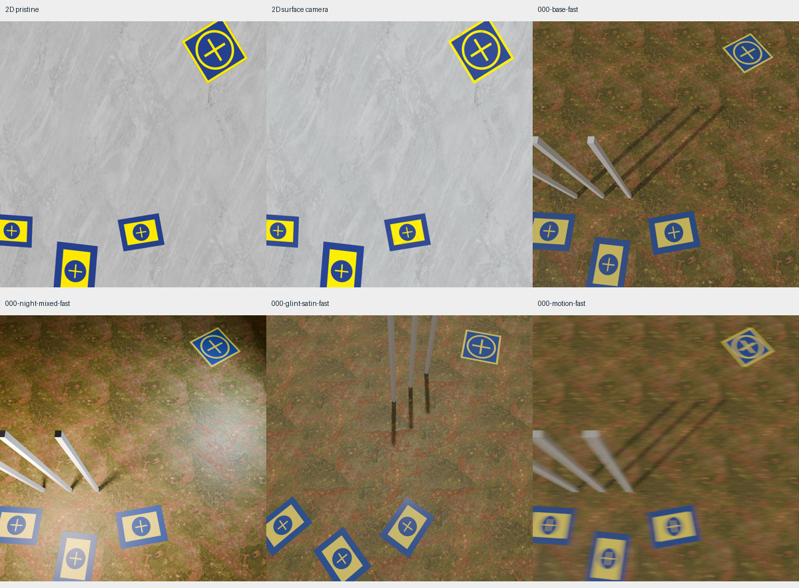
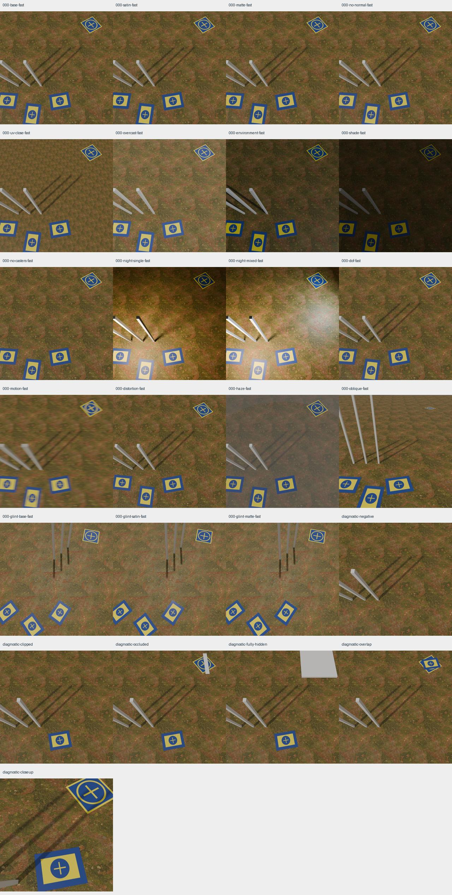
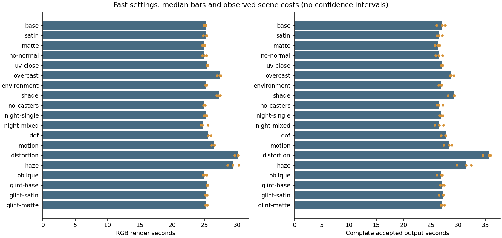
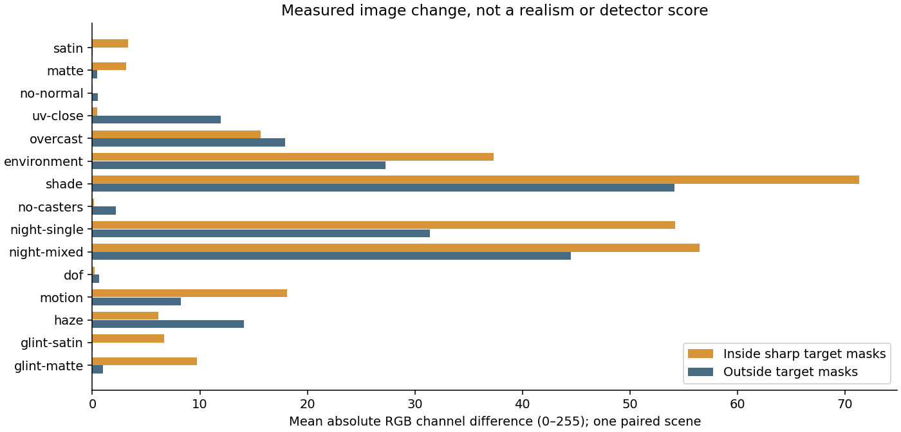
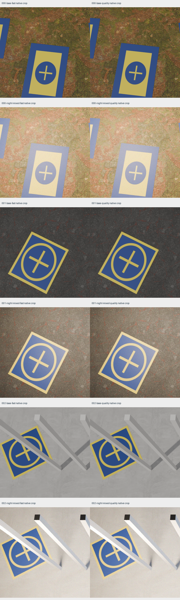
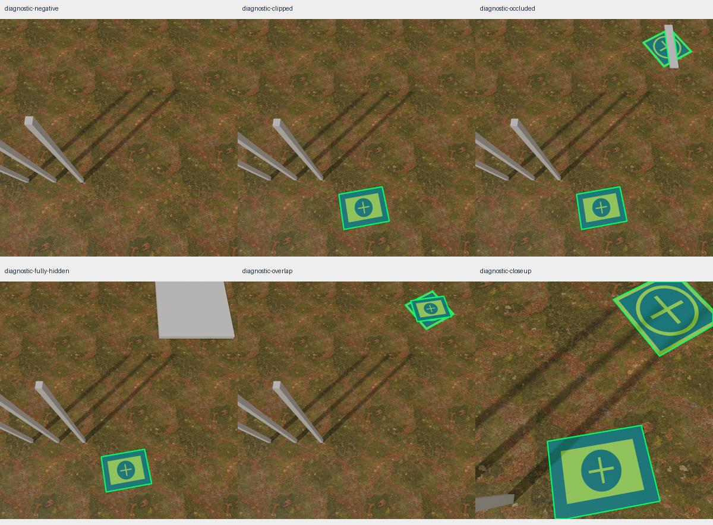

# Targeted physical pad pilot

This is an engineering study on one Linux CPU host: Intel Core i7-13700T,24logical CPUs and approximately16GiB RAM. Rendering source is `3d8a820`;2D controls use clean `8beeee1`. It tests configurable physical cues and annotation
correctness before real captures or trained models are available. It does not measure detector
transfer, calibrate a camera/material, reconstruct a deployment site or establish a universal renderer
speed ratio. The reusable source-checkout workflow is documented in
[the harness guide](../../../experiments/blenderproc/README.md); the later real-transfer protocol remains
in [BLENDERPROC_COMPARISON.md](../../BLENDERPROC_COMPARISON.md).

## Controls and coverage

The normal2D bridge uses the same corrected opaque artwork and the color maps from three CC0 PBR
materials. Pristine and existing surface-camera composers use PNG at1280×1280,2workers,1OpenCV thread,
20accepted outputs plus2warmups. Each is one short exploratory run, rather than a repeated promotion
study; brief unit checks overlapped the pristine control. Their geometry signatures match. The2D recipe samples the shared ground collection independently;3D cycles grounds by scene index. Corresponding gallery views are not registered ground-texture pairs.

The physical arm uses BlenderProc2.8.0 / Blender4.2.1, CPU with6requested render threads,32/128samples,
OpenImageDenoise, adaptive sampling off and4maximum/2diffuse/2glossy bounces. Square1×1m and
rectangle1×0.75m panels are3mm thick with opaque nonmetallic plastic/IOR1.46. Source artwork aspect
and hashes are checked. These dimensions are nominal assumptions. Ordinary panels touch a flat ground;
the deliberately stacked overlap fixture is separate. The ground uses color, roughness and normal
maps, without terrain displacement. Normal strength changes both ground normals and fine pad bump.

Three source scenes supply target centers/counts/width intent from a pinned20-image2D pool and rotate
through Ground068, Asphalt012 and Concrete034. Two hash-pinned1k HDRs supply environment lighting;
explicit sun uses diffuse overcast fill. World placement and projection are physical approximations
of the reference support, not identical cross-engine pixels. Count/width distributions are inspected;
viewpoint and dimensions are configured, rather than inferred from normalized2D transforms.

Nineteen paired treatments cover roughness.25/.5/.8, normal strength, physical UV scale/rotation,
sun/environment/overcast/shade, one/mixed night lamps, environmental shadow casters, haze, f/2DOF,
continuous moving-camera shutter blur, distortion, oblique view and a reflection-sensitive roughness
trio. Base and mixed-night also receive128-sample views on each ground. Six separate diagnostic jobs
cover intentional negatives, clipping, partial/full occlusion, overlap and closeup.

## Measurements

All69jobs completed with no rejected outputs in2418.05s (40.30min), including203.38s of additional
same-sceneRGB measurements. Peak sampled process-tree RSS was2.38GiB; minimum host available RAM
was3.17GiB; additional global swap-out was1.71MiB. All guards passed (2GiB available floor,10GiB
summed RSS,16MiB additional swap-out). The no-op resume added1.92s and preserved all207scene files'
bytes and modification times. These are render-session times; preparation/input hashing, installation,
asset acquisition, report authoring and evaluator preparation are outside that clock.

| Physical setting | Ordinary outputs | Median RGB seconds | Median accepted-output seconds |
| --- | ---: | ---: | ---: |
|32samples,19treatments ×3scenes |57 |25.35 |27.11 |
|128samples, day/mixed-night ×3scenes |6 |76.50 |78.71 |

Accepted-output cost includes setup, geometric annotation and PNG/NPZ encoding, and excludes the extra
warmRGB benchmark renders. The fast-setting median annotation time was1.23s; median eager setup
was0.006s (deferred loading/compilation remains in rendering). Median encoding across all69outputs
was0.47s. Haze's fast median output cost was31.46s and distortion's35.67s, against27.11s for base.
Three observed scenes per treatment are plotted individually, without inferred confidence intervals.
The2D pristine and surface-camera short controls reached1.633 and1.135accepted/s respectively.
They are distinct workloads/execution policies, not a causal engine speed comparison.

Canonical export completed in2.34s:69images and155instances. Both full and visible variants prepared
successfully through the existing evaluator. Both YOLO formats completed on all69images; segmentation
minimum serialized IoU was0.98299, maximum area error1.73%, with18topology-warning instances and up
to5components. No incomplete label set was published. RLE remains exact; polygon loss is explicit.
The final full suite passed335tests; independent Standards and Spec review repairs preceded rendering.

Source2D target-width10th/50th/90th percentiles were13.19/18.13/23.94% of image width. Physical base
achieved15.41/18.28/20.30%. The median is close but tails are narrower; only three scenes (4,1,2targets)
were reused from the20-image reference. This is approximate support matching, not a calibrated or
fully distribution-matched comparison. Future performance/transfer studies need broader camera,
size and count support rather than treating these69paired variants as69independent scenes.

[Portable offline report](index.html) · [Inspect measurements and settings](summary.json)

## What the images show

The physical arm gives material response, illumination, cast shadows and camera optics a common scene.
The night fixture makes the distinction clear: light falloff changes pad and ground together, while
posts cast shadows consistent with that source. Plastic roughness depends on illumination/view angle;
include the reflection-sensitive trio instead of judging its importance from one diffuse view.
DOF and motion blur affect RGB while reference-pose geometric labels stay sharp. Brown–Conrady
lens distortion and Gaussian display-RGB noise are post-render operations, explicitly recorded as such.

The result still has visible synthetic shortcuts. Repeated ground tiles and clean straight posts are
obvious; surface normals give shading without actual terrain relief. A flat support avoids floating
pads but does not reproduce uneven outdoor ground. The artwork is clean and the material lacks
measured color/roughness variation, edge wear and dirt. The noise control does not simulate a raw
sensor, Bayer sampling or camera ISP. These limits matter even when the target edges look sharp.

The one-scene paired RGB measurements make severity concrete: changing roughness to.25/.8 gave
3.32/3.16levels of mean absolute channel change inside target masks in the base view, and6.68/9.71
in the reflection-sensitive view. UV scale/rotation changed background by11.92levels versus0.48
inside targets. Normal removal and f/2DOF gave only0.04/0.18target levels at this configuration;
that weak response does not establish irrelevance at closer distances or other light/material settings.
Shade and moving-camera blur gave71.29 and18.10target levels. Night treatments bundle lighting,
post-display noise (and exposure for single-lamp); their difference is not a pure lighting attribution.
These are mean RGB changes against matched reference masks, not realism or usefulness scores.

The existing2D shared field usefully coordinates image variation, but cannot obtain the view-dependent
material highlights, physical depth optics or mesh-cast shadows shown here from the2D artwork alone.
Adding more independent effects will not establish those relationships automatically. Conversely,
physical rendering of a simple tiled scene does not establish deployment realism. Use this pilot to
choose specific cues to approximate or study, with realistic scene/content variation considered
alongside shading quality. Human review is qualitative evidence; model usefulness remains unknown.

## Annotation, integrity and conversion

Full masks isolate each target; visible masks include true mesh occlusion. Both are sharp geometry at
camera frame0, consistently distorted before final half-open boxes. Any0<in-frame visible/full support
<25% triggers whole-candidate resampling up to8attempts. Fully hidden targets are omitted, accidental
empty positives rejected and intentional negatives explicit. Canonical binary masks and COCO/RLE
remain authoritative; optional YOLO fidelity is reported separately.

Prepared runtime values, job plan, host/child source, reference and asset/artwork hashes are bound to
study identity and checked before rendering/resume. Completed files are hash-checked. Rendering and
COCO/optionalYOLO export share exclusive ownership; export freezes the completed set. Runtime versions
are verified rather than merely asserted in provenance. Review found and repaired the mutable-input,
runtime-payload and export-race gaps before this study.

## Performance implications and next use

Distinguish first command/startup, per-scene setup, annotation/retry, first RGB, repeated same-sceneRGB,
encoding and export. Extra warm RGB measurements consume study time but are excluded from the
single-output cost. These timings rebuild scenes between candidates; same-sceneRGB reuse does not
include new geometry/annotation/output. Installation and asset acquisition were performed beforehand
and were not timed; their hashes/licences and reusable manifests are retained.

The2D and3D arms differ in physical scene, illumination, renderer quality and execution policy, even
though resolution, artwork and ground sources match. Equal accepted-count/time budgets and repeated
training experiments are later work. Do not divide these sparse rates into a causal engine multiplier
or use the synthetic images as evidence of detector benefit. Windows CI covers pure harness/core
contracts; the actual Blender render was exercised on Linux CPU.

The next planning round can select measured scene/material/camera failure cues for2D approximations,
choose richer3D environments and a renderer performance study, and define future real-capture/model
experiments. #59/#61/#62/#63/#64 remain open for those broader requirements; #28 still needs other
hardware classes. Neither a core Blender backend nor model training was introduced.

Reproduce raw rendering with `scripts/blenderproc_pilot.py` and author this compact report with
`scripts/report_blender_comparison.py --study RAW --pristine PRISTINE_POOL --surface SURFACE_POOL
--output docs/experiments/blender-pilot-v1`. Raw assets/images/masks/evaluator copies stay ignored.
