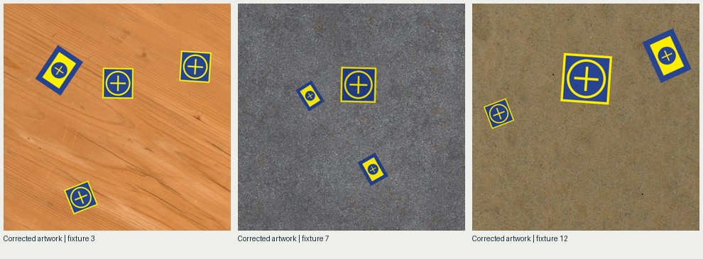

# Corrected pad artwork — initial production baseline

Source commit `51336d6` uses the supplied 500×500 landing and 1000×750 takeoff artwork. Twenty
accepted measured 1280² outputs plus two separate warmups were generated with realistic-heavy,
the standard background mixture, one worker/native thread, no decoded cache and work window two.
The pool completed after 21 candidates and passed inspection. This is one repetition, not a stable
hardware baseline or a detector study.

Measured throughput was 0.0654 accepted images/s (306.2 seconds wall). Background synthesis dominated
the outliers: approximately 183 seconds in one palette-transfer call and 59 seconds in one blend call.
Median render-only duration was approximately 0.573 seconds. Immediately after the run, available
memory was approximately 1.7 GiB and the 2 GiB host swap was full. These observations do not establish
which external condition caused a particular stall.

Preserve the outliers. Do not compare this throughput directly with the older artwork/profile study
or attribute the difference to the larger PNG: source revision, native-thread policy and environment
conditions are material. No worker/cache/default change was promoted.

The compact [measurements](summary.json) retain software, execution settings, stage distributions,
resource peaks, asset hashes and the raw benchmark digest. The full ignored pool/benchmark remains
under `outputs/experiments/realism-round-one/corrected-baseline` in the original workspace.

