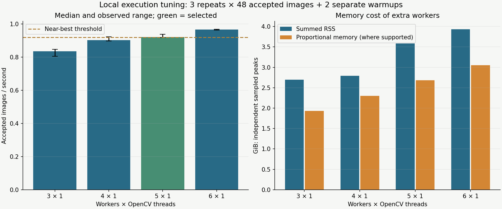
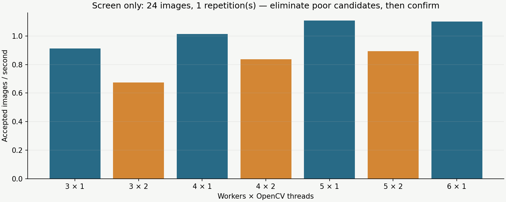

# Worker tuning and a portable recommendation method

This host no longer needs worker-count escalation tests for the current workload. After the earlier
12-worker capacity stops, the useful remaining question was the affordable 3–6 worker range. Six is
fastest here; five is the default near-best recommendation under the explicit 5% tolerance rule.
Four is a useful lower-memory alternative. These are local choices, not generic hardware-class defaults.

[Compact measurements and recommendation](summary.json) · [Portable workflow](../../EXECUTION_TUNING.md)

| Workers × OpenCV threads | Median accepted images/s | Observed range | Max sampled RSS / PSS GiB |
| --- | ---: | ---: | ---: |
| 3 × 1 | 0.835 | 0.806–0.847 | 2.70 / 1.93 |
| 4 × 1 | 0.903 | 0.898–0.923 | 2.79 / 2.30 |
| 5 × 1 | 0.922 | 0.918–0.939 | 3.59 / 2.68 |
| 6 × 1 | 0.967 | 0.964–0.968 | 3.93 / 3.05 |



Every policy has three rotating-order repetitions of 48 accepted 1280² realistic-heavy landing-pad
images plus two separate warmups per repetition. All twelve pools passed inspection and accepted
48 images in 49 attempts. Encoded pixels and content/mask/annotation signatures are identical. The
source is clean immutable `6bd5e13c2c881bd1a7697707ba488ff0bd44b65c`, with the same software versions,
standard background mixture, decoded cache zero, one in-flight slot per worker and four QA outputs.
No competing tests or rendering jobs ran during measurement; authoring and test execution followed it.

Guards were 10 GiB summed RSS, 5 GiB PSS where available, a 2 GiB available-host-memory floor,
16 MiB additional global swap-out, 240 seconds per cell and 0.1-second polling. PSS/USS were sampled
once per second. No guard failed. Minimum available RAM across repetitions was 3.64/3.61/3.16/2.61 GiB
at 3/4/5/6 workers. The three-worker cases recorded 0.52 MiB additional global swap-out in total;
other cases recorded none. Global host activity is not attributable exclusively to the benchmark.

The screen tested 3/4/5 workers at one and two threads and a six-worker single-threaded reference:
one repetition of 24 images plus two warmups per policy. Two threads were about 17–26% slower than
one for those counts, so confirmation focused on single-threaded workers. Screen settings are not
recommendations; their shorter prefix gives different rates from the 48-image comparison.



## What this means

Five workers trails six by 4.73% in accepted throughput, using about 9% less maximum sampled summed
RSS. The resource preference selects five because its median is within 5% of the fastest eligible
median. Four trails six by 6.70%, using about 29% less RSS; it is the smaller choice if the tolerance
is relaxed to 10%. The tradeoff is transparent rather than an asserted unique optimum. Three is
about 13.7% behind six. Ranges overlap for some neighbouring settings, and three repetitions do not
establish statistical significance or a universal performance plateau.

Background synthesis mean call time rises from about 2.01 seconds at three workers to 3.26 seconds
at six while accepted throughput rises only about 16%. That is consistent with shared-resource
contention and bounded-batch stragglers; it does not isolate memory bandwidth, CPU frequency, kernels
or scheduler effects. Basic core counts alone cannot predict the winner. The next performance work
would address algorithm cost or scheduling under a separate plan, rather than increasing worker count.

The portable method now separates:

1. Hardware-informed capacity candidates, using usable CPUs, current available RAM and the complete
   advisory memory model. `workers: auto` uses one OpenCV thread unless explicitly configured, so a
   large backend thread pool is not replicated accidentally across automatic workers.
2. Guarded screening and repeated confirmation with unchanged production content and explicit
   sample/repetition adequacy. The guarded driver records workload/software/hardware compatibility.
3. Evidence-bound local selection: recheck current CPU/headroom, then choose the fewest workers
   within the declared tolerance of the best median. Preserve the original composer's budgets and
   write ordinary typed overrides for explicit preflight/generation use.

The headroom rule is the largest observed available-memory drop ×1.10 plus the recorded reserve.
At recommendation time it required about 5.16 GiB available for five workers and 5.77 GiB for six.
These are workload-local empirical safeguards, not guaranteed future peaks or hard runtime limits.
RSS repeats shared pages; PSS and host availability are separate metrics with independent samples.

## Local setup and reproduction

Ignored local files were created:

- `configs/local/execution-tuning/landing-pad-balanced.yaml`: five workers, one OpenCV thread,
  five in-flight slots and zero decoded cache. This is the primary local composer for the measured workload.
- `configs/local/execution-tuning/landing-pad-fastest.yaml`: six workers, one thread, six slots,
  zero decoded cache; requires more headroom.
- `configs/local/execution-tuning/execution-balanced-overrides.yaml`: the same measured five-worker
  settings as reusable typed overrides for the matching composer.

These do not change the shipped one-worker profile or silently apply to other families/resolutions.
They preserve the original composer's resource budgets. The conservative RSS planner can still warn
that an explicit measured choice exceeds the default 60%-of-available planning budget; empirical
selection does not hide or redefine that warning. Review current preflight before each run.

The generic commands and guard-selection rules are in [EXECUTION_TUNING.md](../../EXECUTION_TUNING.md).
For this study, `execution candidates --workers 3 4 5 6 --native-threads 1` produced the confirmation
matrix. The local base composer is `configs/local/high-workers/baseline.yaml`; the screen matrix also
includes two threads for counts below six. Confirmation used samples=48, warmups=2 and repeats=3
with the guards above. The legacy planner in the pinned renderer is advisory and does not alter the
explicit counts or enforce the watchdog. Recommendations use the current planner separately.

```sh
PYTHONPATH=src uv run python scripts/study_execution_controls.py \
  --source-root .worktrees/high-worker-baseline --config configs/local/high-workers/baseline.yaml \
  --matrix outputs/experiments/execution-tuning/candidates/matrix.yaml \
  --samples 48 --warmups 2 --repeats 3 --rss-limit-gib 10 --pss-limit-gib 5 \
  --min-available-gib 2 --max-swap-out-mib 16 --cell-timeout-seconds 240 \
  --poll-interval-seconds .1 --detailed-memory \
  --output-dir outputs/experiments/execution-tuning/confirmation

uv run python -m dataset_generator_m1 execution recommend \
  --config configs/local/high-workers/baseline.yaml \
  --study outputs/experiments/execution-tuning/confirmation/summary.json \
  --output-dir outputs/experiments/execution-tuning/selected

# Optional authoring dependency, after timing; output must be fresh.
uv run --with 'matplotlib>=3.10,<3.11' python scripts/report_execution_tuning.py \
  --study outputs/experiments/execution-tuning/confirmation/summary.json \
  --screen outputs/experiments/execution-tuning/screen/summary.json \
  --recommendation outputs/experiments/execution-tuning/selected/result.json \
  --output-dir outputs/experiments/execution-tuning/report
```

## Limits and validation

The observations represent one hardware class and repeated deterministic scene prefixes. Defaults
for hardware classes still need additional machines under #28. A changed workload, implementation,
software or material host allocation requires reevaluation. This round does not change smoothing,
scheduling, effects, rendering semantics or quality policy.

298 local tests pass, including recommendation adequacy/compatibility, memory guards, affinity,
automatic threading, counter/hash validation and saved-override reloads. Production-path full CLI,
Windows and exact baseline/current output checks accompany delivery. Charts and links are checked;
raw pools, local composers and host time series stay ignored.
