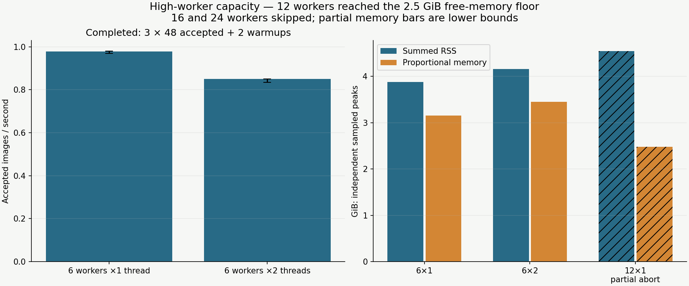
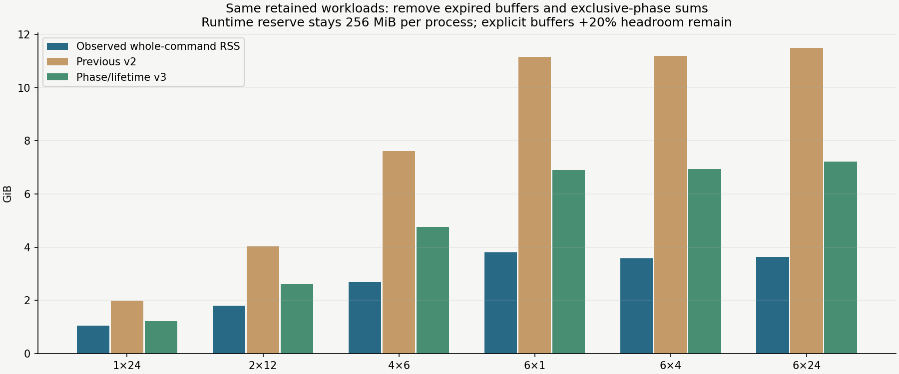
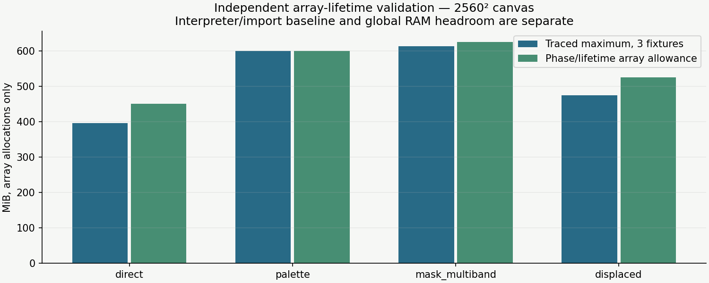

# High-worker capacity and corrected RAM estimates

The 12-worker ramp was stopped by the available-memory guard. Following the user's explicit condition,
12×2,16 and 24 were skipped after that lower-count headroom test failed. This is a host-capacity result,
not a completed 12-worker throughput measurement. No other applications were closed or altered.

[Offline visual report](index.html) · [Compact measurements, allocations and model hashes](summary.json)

## Completed and stopped cases

| Configuration | Outcome | Median accepted images/s | Max sampled RSS / PSS GiB |
| --- | --- | ---: | ---: |
| 6 × 1 | complete | 0.978 (0.969–0.980) | 3.88 / 3.16 |
| 6 × 2 | complete | 0.850 (0.835–0.851) | 4.16 / 3.45 |
| 12 × 1 | guard-aborted | unavailable | 4.55 / 2.48 (partial) |
| 12 × 2; 16/24 × 1–2 | skipped after headroom failure | unavailable | unavailable |

Completed six-worker runs use 3 rotating-order repetitions of 48 accepted 1280² heavy pad images
(+2 separate warmups), standard background mixture, cache 0, window6 and four QA outputs. All encoded
images and mask/annotation signatures match. One thread per worker remains faster. This 48-image
workload includes more scenes than the earlier24-image study; do not call their timing difference a
renderer regression. Repetitions reuse deterministic content and measure execution variation, not 144
independent scenes. Each completed pool accepted 48 images in 49 candidate attempts. Verify actual
attempt counts in the per-repeat evidence when interpreting accepted yield.

The 12×1 ramp uses 12 measured slots, one warmup and window 12, so it can exercise a full 12-worker batch.
It reached the 2.5 GiB available-host-memory floor after about 6.7 seconds, before a complete pool could
be committed. Peak sampled summed RSS was 4.55 GiB; the highest complete proportional-memory sample
was about 2.48 GiB, and no additional swap-out was observed. These partial peaks are lower bounds;
PSS is sampled less often and does not represent physical memory at the exact abort instant. The
minimum available-memory observation was about 2.46 GiB, only slightly below the chosen floor. The
watchdog terminated its isolated coordinator/workers; it did not wait for a failed long run.

The guards were 12 GiB summed RSS, 3.5 GiB proportional memory, 2.5 GiB available host-memory floor,
16 MiB additional global swap-out and 240 seconds per cell. Lightweight RSS/availability/swap checks
use 0.1-second polling; PSS/USS is collected once per second. Sampling can miss spikes and is not a
hard OS memory limit. 16 and 24 need a larger-RAM or otherwise quieter environment before repeating
this same workload; reducing resolution or leaving most configured workers idle would not answer the
requested scaling question.



## The estimator was too loose

On the earlier complete measurements, v2 was 1.89–3.15× whole-command RSS. Shorter generation-only
telemetry sometimes made that difference look close to 4×. The criticism is valid: v2 counted every
historical graph output even after production released it, and added synthesis, foreground processing
and evidence peaks that happen at different times.

Version `phase-lifetimes-v3` uses the renderer's release schedule, operation-specific array scratch,
float32/float64 propagation and the maximum worker phase. Source decode and cover-expansion maxima
stay correlated per asset. Foreground source effects, rotation/resize expansion, masks and evidence
remain accounted for. Runtime reserves stay256 MiB per process; native/cache/coordinator/returned
result reserves remain explicit, with 20% headroom. The serial path reserves one returned sample rather
than a parallel batch. No rendering, geometry, annotation or profile default changed.

Across those same retained cases, the new estimates are 1.16–1.98× observed whole-command RSS, exceeding
every observed complete peak. The previous 6×24 estimate falls 11.49→7.22 GiB against 3.64 GiB observed.
This is still a planning upper estimate: all workers may hit the worst selected recipe together, which
these mixed batches need not realize. It is not a prediction of typical usage or a bound on all native
libraries/effect/source combinations. Missing headers remain explicit uncertainty; automatic worker
counts can rise where the complete phase estimate now fits. Explicit worker choices stay unchanged.



The independent allocation probe uses 3 fixtures per recipe at 2560², native thread 1 and cache 0. It
traces each real production recipe node plus final QA, without retaining array aliases in the probe.
Measured maxima are about 395.3/600.0/612.6/475.0 MiB for direct/palette/mask-multiband/displaced. Phase
allowances are 450/600/625/525 MiB, respectively. Tiny Python tracing metadata is not part of the pixel
formula; the palette discrepancy is about 14 KiB and is covered by separate process/headroom reserves.
These values exclude the import/runtime baseline and untracked native memory, so they are not RSS.



## Memory metrics and provenance

Summed process-tree RSS counts shared fork pages repeatedly. Linux PSS assigns proportional shares of
resident pages and USS measures private pages. The RAM planner continues to expose an RSS planning
upper estimate; it was not silently redefined as PSS to make its error look smaller. Detailed metrics
have independent sampled maxima, so RSS minus PSS at their respective maxima is not a synchronized
shared-memory measurement. The watchdog's available-memory floor applies to the host's actual
headroom independently of these process metrics.

The immutable measured renderer is `6bd5e13c2c881bd1a7697707ba488ff0bd44b65c`; forecasts are calculated
separately with retained model hashes. Background implementation hash/software accompanies the array
probe. Runtime/driver instrumentation was extended with PSS/USS and later finite-limit/abort-metadata
hardening; no measured renderer source was modified. Raw pools, partial abort records, traces and
local policy files stay ignored under `outputs/experiments/high-workers/` and `configs/local/high-workers/`.
Earlier source/software/recipe evidence remains in `../worker-scaling-v1/`.

## Reproduce

Use the shipped `examples/configs/landing-pad_minimal.yaml`, reporting.qa_samples=4, cache 0, native
threads 1 and an explicit matrix. Keep local hardware choices out of tracked generic profiles.

```yaml
schema_version: 1
variants:
  six1: {workers: 6, native_threads: 1, max_in_flight: 6, decoded_cache_mb: 0, ram_budget_mb: 12288}
  six2: {workers: 6, native_threads: 2, max_in_flight: 6, decoded_cache_mb: 0, ram_budget_mb: 12288}
```

```sh
git worktree add --detach .worktrees/high-worker-baseline 6bd5e13c2c881bd1a7697707ba488ff0bd44b65c
# Fresh output roots only. Check current host headroom before every escalation.
PYTHONPATH=src uv run python scripts/study_execution_controls.py \
  --source-root .worktrees/high-worker-baseline --config configs/local/high-workers/baseline.yaml \
  --matrix configs/local/high-workers/ramp-six.yaml --samples 48 --warmups 2 --repeats 3 \
  --rss-limit-gib 12 --pss-limit-gib 3.5 --min-available-gib 2.5 --max-swap-out-mib 16 \
  --cell-timeout-seconds 240 --poll-interval-seconds .1 --detailed-memory \
  --output-dir outputs/experiments/high-workers/six-full
PYTHONPATH=src uv run python scripts/probe_background_memory.py \
  --config configs/local/high-workers/baseline.yaml --samples 3 \
  --output-dir outputs/experiments/high-workers/allocations
# Optional plotting dependency, not a generation dependency. Run after timing.
PYTHONPATH=src uv run --with 'matplotlib>=3.10,<3.11' python scripts/report_high_workers.py \
  outputs/experiments/high-workers --config configs/local/high-workers/baseline.yaml \
  --previous-report docs/experiments/worker-scaling-v1/summary.json \
  --output-dir outputs/experiments/high-workers/report
```

The historical report also consumes `ramp-twelve/abort.json` and its raw system samples. Its matrix has
`twelve1` and `twelve2` with workers/window 12, native threads1/2, cache 0, RAM12288 MiB; the ramp uses
samples12/warmups1/repeats1 and the same guards. Reproducing an abort is capacity-dependent, not a
required outcome on another machine. The report intentionally requires the retained capacity-stop
protocol; adapt a new report for a different machine rather than relabeling a completed ramp as failed.

## Verification and remaining work

274 deterministic tests pass. New regressions exercise dead chains versus live branches, early output lifetime, exclusive phases, extreme foreground aspect/resize, wide-RGB multiband conversion allocations and supported/unsupported proportional-memory sampling. Two lifecycle/phase tests fail on v2 before the fix. Traced allocations for all four shipped recipes agree with the pixel allowances (within 0.5% for small tracing metadata), and revised RSS estimates exceed all retained completed peaks. Platform/CLI checks and exact serial/process baseline comparisons accompany delivery. Charts were visually inspected; all report links are checked. Existing browser policy prevents local-file HTML layout inspection.

The only high-count capacity conclusion is that 12 workers crossed this host-state headroom floor.
No 12-worker completed peak/rate or 16/24 performance is claimed. More physical headroom is required
before those trials. #28 still needs additional environments; smoothing approximation, rolling
scheduling and physical realism remain separate future planning decisions. See `../../HIGH_WORKER_MEMORY.md`.
