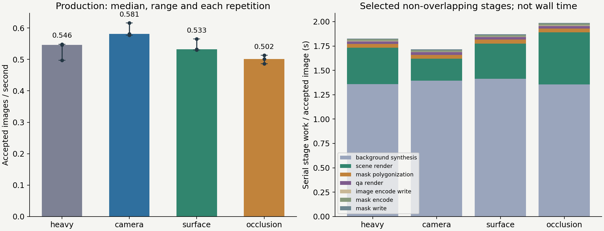
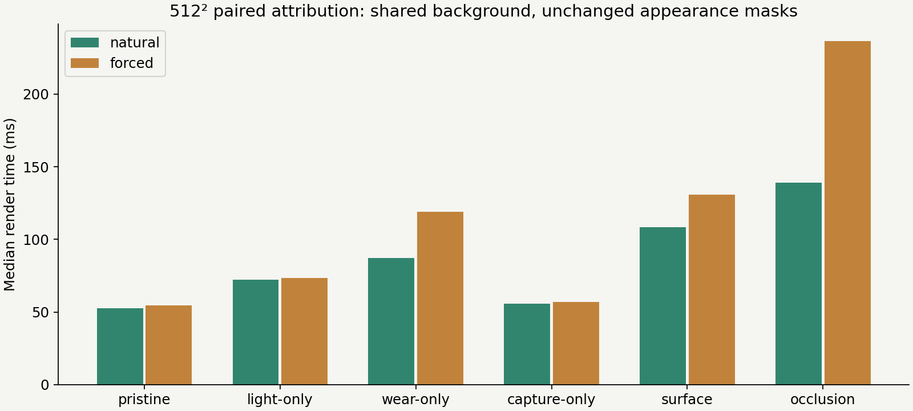
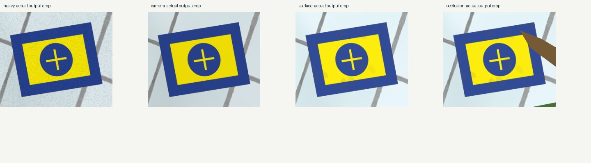

# Round-one planar realism evidence

The selected scope is implemented as opt-ins: offline box/mask evaluation and reference checks, shared linear-RGB scene illumination, foreground-local RGB wear, and procedural scene-plane occlusion with final-mask acceptance. No default promotion or real-world detector benefit follows from these measurements.

## Reproduce

```sh
PYTHONPATH=src uv run python scripts/study_planar_surfaces.py paired --output-dir outputs/experiments/surfaces --samples 20 --warmups 2
PYTHONPATH=src uv run python scripts/study_planar_surfaces.py production --output-dir outputs/experiments/surfaces --samples 20 --warmups 2 --repeats 3
PYTHONPATH=src uv run python scripts/study_planar_surfaces.py report --output-dir outputs/experiments/surfaces
# Optional report-authoring dependency, not a generator dependency: matplotlib>=3.10,<3.11
PYTHONPATH=src uv run --with 'matplotlib>=3.10,<3.11' python scripts/report_planar_surfaces.py outputs/experiments/surfaces
```

Raw pools, per-fixture records and full offline HTML stay ignored. This directory retains compact sanitized measurements, selected contact sheets/crops and charts. Software/source/profile fingerprints accompany measurements; the executed study source precedes later reporting-only/robustness edits. Historical corrected-artwork outliers remain in `../corrected-pad-baseline-v1/` and are not pooled into this repeated comparison.

## Method and limits

The paired screen uses one synthesized background and matching scene intent per fixture, 512² output, natural and forced activation, twenty measured fixtures and two warmups per treatment. Pristine, light-only, wear-only, capture-only and combined surface treatments preserve exact masks and boxes. Occlusion intentionally changes geometry/coverage. Every paired treatment retains candidate/object rejections; activation totals use accepted fixtures and can include foreground calls on objects subsequently clipped out. These totals are application counts, not proof of visible contribution.

Production labels map to `realistic-heavy` (heavy), `camera-minimal` (camera), `surface-camera` + shared lighting (surface), and the same surface configuration + procedural occlusion (occlusion). Production measures these four configurations at 1280², one worker/native thread, no decoded cache, standard background mixture and four QA samples per pool. Each cell has a separate two-image warmup followed by twenty accepted images, three rotating-order repetitions. Same-treatment signatures are stable, and appearance-only production content is identical. Repetitions reuse the same deterministic content, so they estimate execution variation rather than sixty independent scenes. All pools passed inspection. Range bars are observed min/max, not confidence intervals.

Source-resolution work is included: wear acts on the original 500×500/1000×750 supplied pad rasters before resizing. Lighting uses bounded row tiles; procedural layers stream one raster at a time. Mask archive and YOLO polygon costs are separate; holes/components can remain lossy in polygon exports even with exact pool masks. No timing gate or cross-machine recommendation is justified by one host.

## Visual verdict and priorities

The common field provides coherent broad modulation, and local wear changes pigment/dirt/scratch appearance without changing alpha. This is a useful controlled approximation with inspectable seeds and activation. It cannot remove illumination already baked into background photographs, model contact/cast shadows, material reflectance, target relief, wrinkles or depth-dependent optics. The blade/debris fixtures look procedural; keep them as controlled occlusion tests until permitted references or real failure slices justify richer assets/geometry.

Geometric validity and perceived sharpness do not establish the distribution seen by a vision model. The next evidence priority is a separate permitted real development/holdout set with external predictions, known label policy and measured target/capture conditions. Use failure slices to choose the next improvement. Performance work should target measured background synthesis, repeated source decoding/resizing, and polygon/QA/output costs before changing fidelity blindly. Evaluate caching against representative reuse with hard memory bounds; separate source-resolution and mixture changes because they alter content/diversity.

Physical calibration, PBR/raised geometry, imported occluders, training/inference and Blender runtime remain outside this round. See `../../BLENDERPROC_COMPARISON.md` for matched engine, annotation, equal-size/time and full-cost protocol; #59/#61–64 retain their remaining real/physical acceptance requirements.

## Local measured result

| Profile | Median accepted images/s | Observed range |
| --- | ---: | ---: |
| heavy | 0.546 | 0.497–0.549 |
| camera | 0.581 | 0.577–0.616 |
| surface | 0.533 | 0.531–0.565 |
| occlusion | 0.502 | 0.487–0.513 |

Every repetition accepted20 images in21 attempts. The minimum available host memory was about5.87GiB, while existing swap use reached about1.97GiB. This does not establish a cause for timing variation. Generation throughput excludes preparation/warmup; raw command durations retain them.







Charts, crops and selected sheets were visually inspected and all10 offline report links resolved. Browser layout inspection was unavailable because the browser URL policy blocks local file URLs; no server workaround was attempted.
