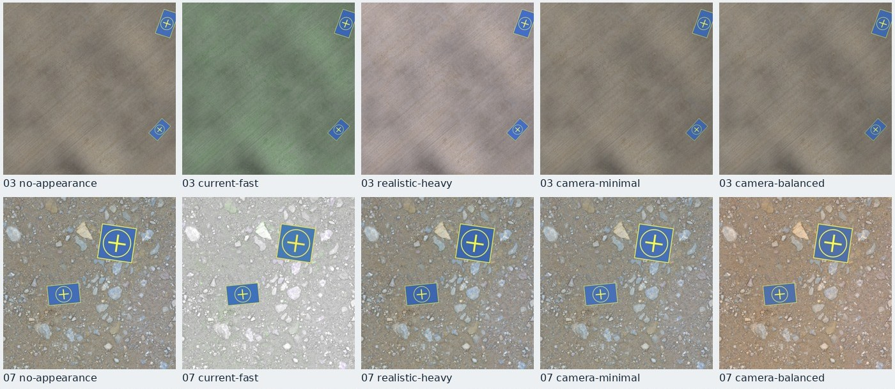
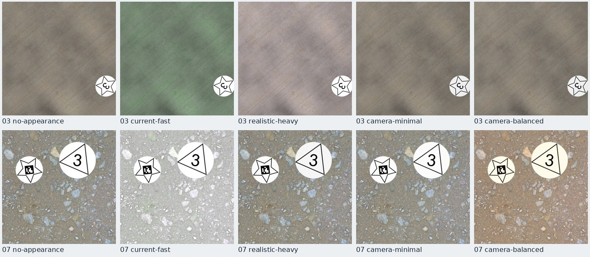
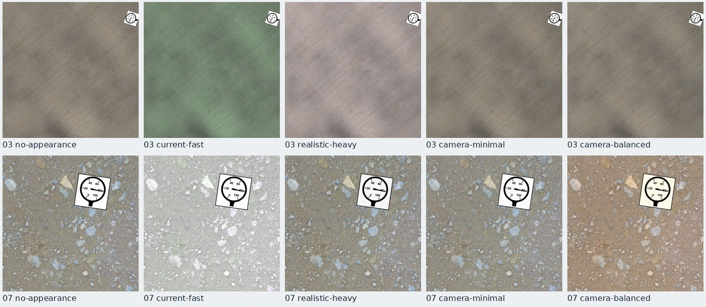

# Generation-profile tradeoffs v1

Local initial evidence from the open execution-planning delivery at base `96a539d`. The working tree
contains the new experimental profiles and study scripts; core renderer/synthesis algorithms were not
changed. Linux/Python 3.13, 24 logical CPUs and approximately 16 GB RAM, with existing memory pressure.
This is a configuration comparison, not a hardware-class recommendation or a detector-quality study.

## Production comparison

Five composers, three rotating-order repetitions, 20 accepted measured images per cell and two separate
warmup images. Total: 300 measured + 30 warmup outputs. A fresh process runs each cell. All composers
use the same 1280² pad task, count policy, source catalog, execution policy and 16 QA images per pool.
The first four differ only in appearance. Direct-camera changes the background recipe mixture explicitly.
Reported active throughput includes retries, mask persistence/polygonization, image writing and configured
QA. Preparation/probes and warmups are excluded. Wall times, resource peaks and per-run counters remain
in the JSON. Individual child benchmark files have one repetition; this combined study supplies three.

| Composer | Three repetitions (accepted images/s) | Median images/s | Maximum sampled tree MiB |
| --- | --- | ---: | ---: |
| Current fast | 0.605 / 0.617 / 0.604 | 0.605 | 1208 |
| Realistic heavy | 0.412 / 0.492 / 0.466 | 0.466 | 1146 |
| Camera minimal | 0.557 / 0.626 / 0.610 | 0.610 | 1081 |
| Camera balanced | 0.632 / 0.617 / 0.621 | 0.621 | 947 |
| Direct + minimal camera | 1.008 / 0.986 / 0.987 | 0.987 | 1212 |

All 15 measured pools completed and passed inspection. Appearance-only geometry/annotation/mask
signatures match. All 15 pools also have identical foreground annotations and mask evidence, including
the content-changing mixture. Each pool accepted 20 images after 21 candidates and retained 59 objects.
Best effort does not guarantee every requested instance. Source/background differences and inspector
success are distinct from visual legibility and dataset distribution quality.

Camera candidates have similar measured throughput; their small ranking difference does not establish
an intrinsic speed ordering. Host memory and OS load varied. No tuned execution policy or default was
promoted. The direct mixture offers the largest local gain by reducing synthesis diversity, not by
silently reducing dimensions, masks, foreground counts or QA.

## Paired visual and appearance studies

- All three families: 20 full-size paired fixtures and two warmups. Pad stage ablations isolate the
  actual shipped heavy background, foreground and final stages; they are not the historical combined
  default-study stack.
- Pads repeat at 640² with the same composer/seed/count policy. Resolution changes target detail and
  rasterization; it is not an execution-only optimization or a cross-resolution pixel invariant.
- Four-fixture diagnostics force selected profiles and every heavy effect; all three native fog modes
  and separate RandomFog are retained. The named stress/fog bundles also receive a short screen.
- Native fog and RandomFog use different parameters/severity. Their timing is not an equal-opacity
  quality comparison. Forced probability is diagnostic, not ordinary prevalence. Sparse natural
  activations have explicit low-coverage warnings.
- Every appearance pair checks geometry, annotations and mask signatures. Render-only and modeled
  synthesis/render/JPEG/write cost remain separate from accepted-output production throughput.

At 1280², mean realistic-heavy/camera-minimal render times were 0.417/0.158 s for pads,
0.436/0.157 s for landing shapes, and 0.334/0.077 s for manometers. For pads, modeled cost was
1.980/1.719 s: background work remains even after appearance becomes cheaper.

Visual review of selected natural rows and forced cases:

- Current-fast has useful broad colour randomization, but can turn ground green/red or wash out gravel;
  its name does not imply the most plausible physical scene or the fastest complete pipeline.
- Heavy appearance creates stronger noise/light/weather variation. Independent foreground/background
  light does not produce coherent contact lighting; heavy perturbation is not synonymous with realism.
- Daylight and motion scenarios are restrained. Overcast can make dark source ground too dark. Mild
  haze is uncalibrated. Rare activations need forced coverage before claiming an effect was evaluated.
- Camera-minimal preserves more source colour with restrained final lighting/exposure, short blur and
  mild JPEG variation. Camera-balanced adds occasional low-amplitude noise and colour temperature.
  These are useful candidates for review, not calibrated sensor models or evidence of detector lift.
- Four-fixture all-effects-stress rendering averaged 1.777 s versus 0.385 s for heavy in that small
  diagnostic. In inspected fixture 0 the pad was effectively unrecognizable under fog/rain despite
  passing geometry/mask invariants. It demonstrates stronger perturbation/cost, not a desirable realism endpoint.
- The provided foreground artwork is synthetic. No profile supplies physical scale, true 3D perspective,
  physically coherent illumination or contact shadows. Real reference images/predictions were not supplied.

Selected fixtures 3 and 7: no appearance / current fast / realistic heavy / camera minimal / camera
balanced, left to right. These are review subsets, not an exhaustive visual-quality rating.





## Background operation costs

Twenty measured + two warmups per recipe on the actual 2560² scene canvas, rotating order and a common
first source per fixture. Wrapped production functions have non-overlapping wall-time scopes; QA is on.

| Recipe | Mean synthesis | Important observed work |
| --- | ---: | --- |
| Direct | 0.515 s | 0.271 s QA; 0.047 s decode/float; 0.045 s resize/crop |
| Palette | 1.496 s | 0.882 s colour transfer; 0.264 s QA |
| Multiband | 2.037 s | 0.480 s mask preparation; 0.582 s blending; 0.320 s QA |
| Displaced | 1.591 s | 0.718 s displacement; 0.290 s QA |

First performance investigations should target full-canvas validation/conversions/temporary arrays,
palette work and multiband/mask preparation. Preserve safety semantics; reducing QA resolution or
weakening thresholds would be a separate reviewed quality decision. Decode caching is not the primary
cost shown here. Background effects touch 6.55 MP versus final effects' 1.64 MP. Foreground effect cost
follows each source cutout's dimensions before output resizing. Never add inclusive renderer spans to
nested exclusive spans.

## New explicit candidates

- `builtin:appearance/camera-minimal` and `builtin:appearance/camera-balanced`: experimental and
  family-unrestricted. Shared stable IDs preserve common effect streams between these two profiles.
- `builtin:background_mixing/direct-dominant`: 80/15/5/0 direct/palette/multiband/displaced versus
  standard 45/20/25/10. Weights are probabilities, not quotas. It deliberately reduces synthesized
  diversity and retains all current background QA.
- `examples/configs/landing-pad_camera-minimal.yaml` preserves the standard mixture;
  `examples/configs/landing-pad_direct-camera.yaml` makes the content tradeoff explicit.

Existing defaults and historical studies remain unchanged. No machine-specific worker/cache/thread
settings were promoted. Visual adequacy here is a reason to try a candidate, not a training claim.

## Generic foreground test and limits

Maintained artwork: 201 manometer images/5 classes; 18 shape images/12 classes; 2 authored whole-pad
images/1 class. The shared image renderer is not hardcoded to those silhouettes.

An isolated temporary family with shipping-label and tool classes used authored RGBA label/wrench
cutouts. Both serial and two-worker ten-image pools passed inspection and matched geometry, annotations
and masks: 12 candidates, 18 retained objects (9 per class). Detection export completed. Segmentation
export completed with warnings: the persisted masks preserve wrench holes, but one-polygon YOLO export
fills them. Nine of 18 instances warned; worst raster IoU 0.978593 and maximum area error 2.1875%.

Generic onboarding is incomplete. The resolver loads installed family definitions; a new definition
also needs compatible profile bundles. The initial probe correctly refused standard bundles restricted
to maintained families. Explicit local bundles resolved that gate without renderer changes. The scratch
family remains only in the retained isolated checkout and is not a new production task.

For existing classes, configure foreground paths, naming/mapping rules, group/asset weights, attempted
count/size ranges, spacing, placement budget and visible fraction. Family policy controls class order,
rotation and alpha threshold. RGB inputs are opaque rectangles; transparency requires alpha. There is
no automatic background removal/class inference or true 3D relighting. Nested relationships remain #31.

## Reproduce

Run from the repository root with locked dependencies. Always choose fresh ignored output directories.

```sh
uv run python scripts/study_profile_tradeoffs.py --family landing-pad --samples 20 --warmups 2 --output-dir outputs/experiments/profile-pad
uv run python scripts/study_profile_tradeoffs.py --family landing --samples 20 --warmups 2 --output-dir outputs/experiments/profile-landing
uv run python scripts/study_profile_tradeoffs.py --family manometro --samples 20 --warmups 2 --output-dir outputs/experiments/profile-manometro
uv run python scripts/study_profile_tradeoffs.py --family landing-pad --mode effects --samples 4 --warmups 1 --output-dir outputs/experiments/profile-effects
uv run python scripts/study_profile_tradeoffs.py --family landing-pad --mode forced --samples 4 --warmups 1 --output-dir outputs/experiments/profile-forced
uv run python scripts/study_profile_tradeoffs.py --family landing-pad --mode stress --samples 4 --warmups 1 --output-dir outputs/experiments/profile-stress
uv run python scripts/study_background_costs.py --samples 20 --warmups 2 --output-dir outputs/experiments/background-costs
uv run python scripts/benchmark_profile_composers.py --samples 20 --warmups 2 --repeats 3 --output-dir outputs/experiments/profile-production
```

Use `--size 640` for the resolution comparison. Run one benchmark at a time, keep intended production
quality/QA explicit, and record OS memory pressure. Source artifact hashes, profile definitions, coverage,
software identity, coarse hardware scope and exact compact measurements are in `summary.json`. Full raw
bundles, local composers, the interactive report app and downloaded/generated evidence stay ignored.

Validation: 162 Linux/Python 3.13 tests passed; all study HTML/JSON links and invariants checked; production
and generic pools inspected; both generic exports exercised; wheel/sdist include new bundles and exclude
raw outputs/caches. The local report's controls, source-scoped rows, decoded images and desktop/mobile
DOM geometry were checked. In-app screenshot, native card-image capture and mouse-driven source-inspector checks were unavailable, so no full
browser screenshot acceptance is claimed. Paired source sheets were inspected directly.

The branch is the latest open PR #60, with #51 → #53 → #54 → #55 → #58 as dependencies. Relevant remaining
work: #27 QA calibration, #28 additional hardware evidence, #29 count fulfillment, #31 nesting and #59
external prediction evaluation. No PR was merged or pushed by this study.
