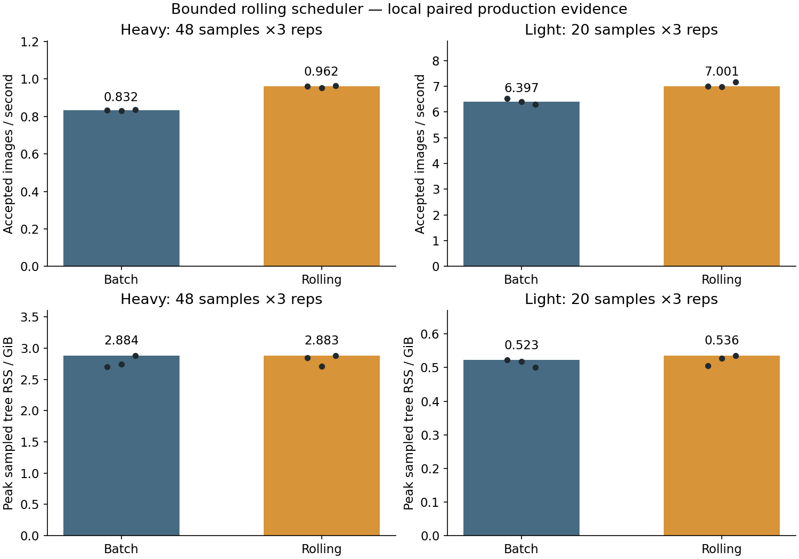

# Bounded ordered rolling scheduler

Paired clean-source production study on one host: baseline `1771e2d`, rolling `c3ad473`, Python3.13,
one OpenCV thread, no decoded cache and queue cap equal to workers. Three rotating repetitions per
arm; heavy1280² pad workload uses4workers and48accepted+2warmups, light320×240 landing uses2workers
and20accepted+2warmups. QA/output/masks/retries are included in accepted throughput.

| Workload | Batch median accepted/s | Rolling median accepted/s | Median gain | Peak RSS change |
| --- | ---: | ---: | ---: | ---: |
| Heavy |0.8323 |0.9617 |+15.55% |−0.03% |
| Light |6.3974 |7.0010 |+9.43% |+2.54% |

All encoded images and logical mask/annotation signatures match across all12cells. Neither the
foreground pipeline nor background mathematics changed. All guards passed:10GiB summed tree RSS,
2GiB host available floor,16MiB additional swap-out,0.1s polling. Detailed PSS was observed where
available and is not substituted for RSS. Peak tree RSS in the heavy arms was approximately2.884GiB;
minimum available memory exceeded3.27GiB. No high-worker retuning or generic hardware default is implied.

The admission cap includes running futures, completed result payloads and the result being committed.
Ordered commits release a slot before replenishing it. Pause/stop prevents admission after observation,
drains existing work, then checkpoints. Adversarial tests cover skew, errors, external control,
interrupt/reaping and multi-slot serial/process equality for all maintained families. An independent
review found timing-dependent test synchronization; explicit events replaced those assumptions.

Promotion verdict: all agreed correctness/throughput/RAM gates passed. Rolling replaces batching;
there is no permanent public selector. The source version records the old baseline for reproduction.
Exact generations retain their identity; performance observations move to `bounded-ordered-rolling-v1`.

Reproduce the raw studies with `scripts/study_execution_controls.py` using separate immutable source
roots and the recorded policy/guard/count settings. Build these figures with
`scripts/report_rolling_scheduler.py --heavy RAW_HEAVY --light RAW_LIGHT --output-dir REPORT`.
Dots are three observations, not confidence intervals. Workload panels use different absolute scales.
