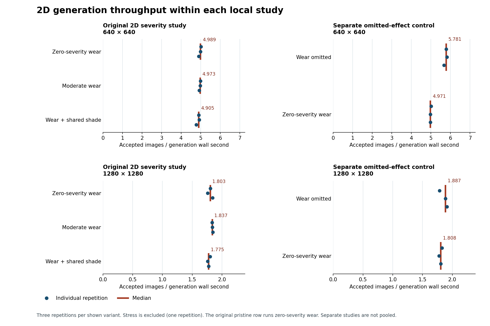

# Shared surface integration

This round adds registered wear maps and configurable physical scene controls while keeping production
defaults unchanged. Ordinary wear remains an opt-in variation. General contextual-caster and glint
recipes remain exploratory: visual review found blocky shadow features, texture repetition/uncertain
scale and a finite-ground boundary. No real captures, trained-model comparison or physical calibration
support a detector-benefit claim.

Implementation: [PR #79](https://github.com/edra-unb-fga/dataset_generator_m1/pull/79), stacked on
[PR #78](https://github.com/edra-unb-fga/dataset_generator_m1/pull/78). Scope and deferrals are in
[round three](../../REALISM_ROUND_THREE.md); commands and bounds are in the
[harness guide](../../../experiments/blenderproc/README.md).

## What changed

The same deterministic normalized wear fields now feed legacy 2D RGB appearance and source-sized 3D
albedo, roughness and bump PNGs. The albedo path preserves old RGB/trace/random draws and foreground
alpha. Roughness and height are nominal linear data maps; height changes shading, not the rigid panel
outline. Separate pad bump, ground normals/UVs, environment rotation/intensity, lamps and contextual
casters are saved configuration. The nominal panels remain 1 m square / 1 × .75 m, 3 mm thick, on planar
support. The optional harness accepts one to six reviewed grounds and one to three HDRs.

The optional 2D shade field attenuates composed target and ground together through the same homography,
before capture effects. Its own random stream preserves other lighting draws, alpha, masks and
annotations. A targeted review found smooth crossings in scenes 016 and 018. This is a soft qualitative
field, with no inferred environmental geometry or physical contact shadows. It remains experimental.

## Throughput and what the similar rates mean

The first production-path study contains 400 measured outputs and 40 warmups. Ordinary severity
variants use 20 measured outputs after two warmups, three rotating-order repetitions at each size;
stress has one repetition per size. Five workers and one native thread are a saved local policy, not a
generic hardware default. All paired geometry, annotations and full/visible masks match, including the
20 original reference intents.

| Local CPU output | Zero-severity wear | Moderate wear | Moderate + shade |
|---|---:|---:|---:|
| 640 × 640 | 4.989 images/s | 4.973 images/s | 4.905 images/s |
| 1280 × 1280 | 1.803 images/s | 1.837 images/s | 1.775 images/s |

These are medians of accepted images divided by generation wall seconds. Small differences do not
establish a speedup. In particular, the zero-severity control still executes the wear operator:
field allocation, resizing and full source-array float blending share most work with moderate wear.
Consequently this severity comparison cannot measure the cost of enabling the operation.

A separate omitted-operation control adds 240 measured outputs and 24 warmups, with the same two
warmups, 20 measured outputs and three alternating repeats per condition and resolution:

| Local CPU output | Wear omitted | Zero-severity operation | Median paired gain from omission |
|---|---:|---:|---:|
| 640 × 640 | 5.781 images/s | 4.971 images/s | 15.52% |
| 1280 × 1280 | 1.887 images/s | 1.808 images/s | 5.62% |

All 120 paired PNGs are byte-identical, with equal masks, geometry and annotations. The 1280 result is
small and noisy: one pair favors the zero-severity run. Both controls retain neutral common
illumination and premultiplied filtering, so this is an operator omission test, not an all-effects-off
pipeline. The new pristine example omits wear; the original severity data stays frozen and labeled.

T4 confirmation uses a separate measured-command denominator. Two warmup outputs and every capability
probe are recorded and charged separately; measured commands include worker startup, scene setup,
annotation attempts, rendering and output writing. Three alternating repetitions cover core and wear
at 640 and 1280. The warmup phase has two accepted outputs; the inherited first-scene
same-view timing check also performs two auxiliary RGB renders, retained in scene metadata and charged
to that warmup command. Measured jobs do not have that first-scene flag. The first timing pass overlapped qualification archive compression/file transfer and
is excluded from performance conclusions. Its costs remain charged; only the isolated repeat is used.
The isolated confirmation accepted all 240 measured outputs, plus 24 accepted warmup outputs:

| Colab T4 output | Pristine core | Registered wear | Saved worker policy |
|---|---:|---:|---|
| 640 × 640 / 32 samples | 0.606 images/s | 0.590 images/s | 2 workers × 1 native thread |
| 1280 × 1280 / 32 samples | 0.181 images/s | 0.180 images/s | 1 worker × available native threads |

These are medians of accepted outputs divided by measured command wall time. The median of paired
wear/core changes is −0.84% at 640 and −0.58% at 1280; signs vary across repetitions. This is comparable
command cost for these two treatments, not proof that preparation or physical material maps are free.
The retained compact records contain exact rates and resource peaks. Different hosts, output work and
timing denominators prevent a causal 2D-versus-3D speed multiplier.

## Coverage and correctness

| T4 qualification | Resolution / samples | Completed jobs | Accepted images / visible annotations |
|---|---|---:|---:|
| Shared core, 20 reference intents | 640 / 32 | 66 | 66 / 185 |
| Quality and material controls, three intents | 1280 / 32 and 128 | 51 | 51 / 113 |
| Reserved combinations, six intents | 1280 / 32 | 42 | 41 / 97 |

Core includes pristine, wear and a same-sample quality-label control, plus six mask diagnostics. Quality
includes matched fast clean/wear pairs, high-sample selections, UV/context comparisons and heavy stress.
Use 32/32 comparisons to isolate wear; 128-sample wear versus 32-sample clean changes sampling as well.
Within the same wear treatment, 32 versus 128 isolates the sampling change. Forty-one final fast-pair
comparisons have identical full/visible masks and abstract geometry.

The reserved overlap diagnostic is the one rejected output: all eight attempts leave one target at
about 7.9% visible support, below the unchanged 25% floor. The run completed and retained that rejection;
ordinary samples all accepted. Negative, clipping, hidden, overlap and occlusion controls preserve
sharp reference-pose label conventions. COCO and evaluator-ready exports are separate from visual
judgment. No acceptance floor was lowered.



Stage counters are aggregate worker work, not a wall-latency budget: median foreground-effect work
for zero-severity/moderate is 95.65/96.09 ms per accepted output at 640 and 96.75/94.62 ms at 1280.
The nearly fixed source-array cost helps explain why omitting wear matters more at the smaller
output size. Concurrent workers and nested stage timers must not be summed as wall-clock shares.

Development used indices 0–2. The reserved pass used indices 4–9 with a new seed and was reviewed once
without further tuning. Core covers all 20 source layouts, so these are new synthetic combinations,
not globally held-out layouts and not real evaluation data.

## Visual decisions

- **Pristine and moderate wear:** retain opt-in; patterns remain recognizable. Ordinary wear is often
  subtle at task scale. A strong physical roughness/bump advantage is not established by these views.
- **UV scale:** expose and retain controls, but do not promote 8 m universally. Fewer repeats can make
  cracks or vegetation implausibly large; physical scale remains unknown.
- **Context integration:** exploratory. Dark blocky/pole-like features and blunt bars enter the image;
  convincing target-crossing shade was not established. Casters are configured camera-invisible.
  A separate local check verifies that property through mask and beauty passes, while shadow/glossy/
  diffuse rays stay enabled. That check does not identify which rays create the dark features.
- **Glint:** exploratory. The oblique camera exposes the finite ground plane in some combinations;
  localized plastic glint is not convincingly established.
- **Night:** retain as an explicit mixed-light specialist with exposure caveats; this is nominal
  artificial lighting, not calibrated night-camera response.
- **Heavy wear:** stress only; obvious flat blotches are not an ordinary realism target.
- **2D environmental shade:** coherent shared-field behavior is supported; general realism/default
  promotion remains deferred.

## Reproduction and retained evidence

Saved definitions are `experiments/blenderproc/studies/surface-integration.json`, `surface-2d.json` and
`surface-2d-omitted.json`. The two 2D drivers/controls retain their source snapshots. The physical study
controller freezes the matrix, records its own SHA and source/input identities, and shares an exclusive
budget ledger with the isolated prototypes. `--study-id performance-isolated` retains a fresh timing
pass without replacing earlier evidence. Source archives include the study drivers and verified
registered maps; no Git clone is needed in Colab.

Raw pools, full assets, portable input/evidence archives and the full interactive HTML remain ignored.
This folder retains sanitized compact measurements, selected synthetic review images and provenance.
The full report is built by `scripts/report_surface_integration.py`; its HTML authoring runtime is the
installed Data Analytics plugin (`DATA_ANALYTICS_PLUGIN_ROOT`), with `CODEX_NODE` or Node on PATH.
Reproducing the tracked quantitative PNGs also requires Matplotlib, NumPy and Pillow. These
report-authoring dependencies are separate from generation and Blender dependencies. The emitted
standalone HTML includes its visual content for offline use.

The first prototype attempts failed before Blender rendered because the entry docstring preceded the
literal-first-line BlenderProc import. A second attempt stopped at a stale wrapper path before Blender
launched. Both mechanical repairs are retained on the isolated
[`codex/surface-context-prototypes` branch](https://github.com/edra-unb-fga/dataset_generator_m1/tree/9f24c42),
never merged wholesale. A local 64-square/one-sample engineering smoke accepted four outputs for each
prototype and verified both GLB imports; it is not a realism or throughput qualification.
A separate local CPU comparison then completed four matched baseline, relief and imported-context jobs
per track at 640-square/32 samples (12 accepted outputs). All four full/visible masks match the baseline
for each prototype; placement avoided pad bounds, so this is not an actual occlusion test. Single-run
worker times were 118.40 / 119.69 / 118.22 s, with differing startup/probe arrangements and no observed
swap-out; no relative speed conclusion follows. Fresh Terra review keeps both prototypes exploratory:
smooth oval relief is not varied terrain, and sparse/clipped rock/branch placement has unresolved scale
and possible contact gaps. The code/import path works, but a general realism improvement is unproven.
The copied local evidence retains source paths and is not a standalone input bundle.

The total T4 probe/render/warmup/retry budget is 7200 s, with at most 1440 s for wider prototypes and
720 s cumulatively for each kind. Budget reservations survive interruption conservatively. Setup,
asset acquisition, local short diagnostics and export costs are reported separately.

The Colab allocation ended while final archiving was pending. The qualification archive and all 766
member hashes were already verified locally, and the complete isolated timing summary was retrieved
with its command/resource/source records and paired signatures. The last raw per-cell archive, final
ledger and queued R2 prototype results were not recovered. No remote prototype completion is inferred.
The last observed cumulative charge is 3,280.35 s; it is a lower bound, not the final total. The only
subsequent queued work had at most two 720 s prototype allowances, giving a conservative upper bound
of 4,720.35 s, below the 7,200 s cap. This allowance bound is not a measured duration. Colab subsequently
reported no active sessions on the server; no further GPU allocation was created. For future remote
studies, retrieve per-cell checkpoints before building the larger final archive.

## Next planning round

Prioritize measured asset/UV scale, ground extent/framing and contextual geometry/ray behavior before
adding more random effects. Improve ordinary wear only against a defined material/appearance target;
keep stress distinct. Source-size work, no-op effects, repeated derivative preparation and annotation/
startup amortization are performance candidates requiring controlled measurements and deterministic
contracts. Real captures, camera/ISP calibration, trained-model transfer, general scene geometry and a
core Blender backend remain deferred under #59/#61/#62/#63/#64. Additional hardware-class baselines
remain open under #28. The engineering results do not close those evidence requirements.

Cell-level host map-preparation wall time was not recorded outside the bootstrap. Measured-command
rates exclude it; clean bootstrap stage timings provide a bounded setup example rather than a complete
per-cell acquisition/modeling cost. Asset acquisition and human review effort are not timed totals.

One deterministic ordinary-wear map illustrates the restrained contrast: roughness codes span 125–143
out of 255 (about .49–.56), and the height map spans only 124–131, eight encoded levels. Together with
small nominal bump settings, this helps explain subtle shading differences. These are artifact code
ranges, not measured surface roughness or physical relief; no silhouette displacement is applied.

To rebuild the full report from these retained local evidence folders, with the report-authoring
runtime installed and configured:

```bash
study_root=outputs/experiments/surface-integration
python scripts/report_surface_integration.py \
  --cpu-study "$study_root/cpu-smoke" \
  --two-d "$study_root/two-d" --two-d-control "$study_root/two-d-omitted" \
  --three-d "$study_root/remote-preview/study" \
  --three-d "$study_root/qualification/study" \
  --three-d "$study_root/qualification/bootstrap/study" \
  --performance "$study_root/isolated-timing-summary/summary.json" \
  --prototype "$study_root/prototypes/local-review/comparison-summary.json" \
  --reviews "$study_root/reviews" --output "$study_root/report-app" \
  --compact-output "$study_root/report-compact.json" \
  --asset-root "$study_root/assets" \
  --artifact-dir docs/experiments/surface-integration-v1 --complete
```

The raw folders are local ignored evidence, not downloaded automatically by this command. Use the saved
study definitions and harness guide to generate a new study. `--complete` verifies the required inputs;
it does not certify realism or erase the documented retrieval gaps. The final build and source/image/link
checks passed; interactive browser layout QA was unavailable because no browser surface was connected.
