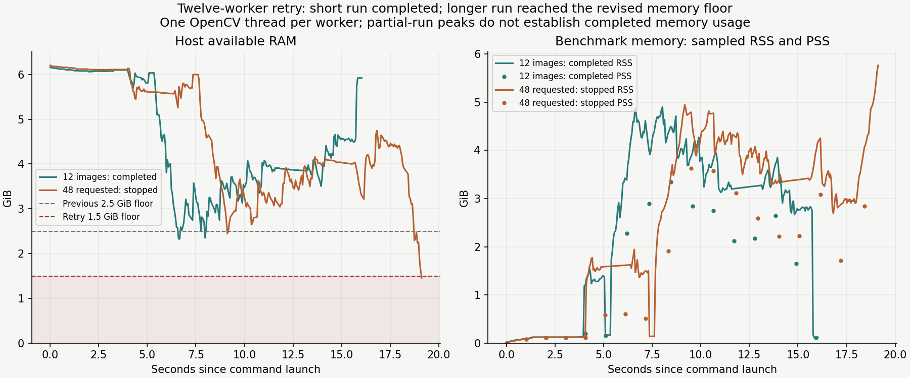

# Twelve-worker retry with a lower memory floor

The twelve-worker short run completed after the available-memory floor was lowered from 2.5 to
1.5 GiB. The longer workload still reached that revised floor during its second batch and was
terminated. Neither run exhausted RAM. This refines the [earlier capacity result](../high-workers-v1/README.md):
the original stop was conservative for the short prefix, but that prefix did not demonstrate enough
headroom for the longer workload.

[Compact measurements and source provenance](summary.json)

| Measurement | Short run: completed | Longer run: stopped |
| --- | ---: | ---: |
| Requested measured images | 12 | 48 |
| Separate warmup images | 1 | 2 |
| Measured images committed | 12 | 12 |
| Available RAM at start | 6.16 GiB | 6.20 GiB |
| Minimum available RAM | 2.33 GiB | 1.46 GiB |
| Peak sampled summed RSS | 4.90 GiB | 5.76 GiB, partial |
| Peak sampled PSS | 3.34 GiB | 3.63 GiB, partial |
| Additional global swap-out | 2.79 MiB | 0.00 MiB |
| Whole command duration | 16.10 s | 19.20 s before termination |
| Accepted images/s | 1.151 | unavailable |



Both cases use twelve workers, one native OpenCV thread each, twelve in-flight slots, no decoded
cache, 1280² realistic-heavy landing-pad generation, the standard background mixture and four QA
outputs. Sample evidence confirms twelve distinct worker processes in both attempts. The renderer is the clean immutable commit `6bd5e13c2c881bd1a7697707ba488ff0bd44b65c`. The watchdog
is the merged PR #72 implementation; its hash, exact guard limits and software versions are retained.
The immutable renderer still emits its historical v2 advisory RAM estimate; that estimate does not
enforce the watchdog or change rendered content. No source, planner or default configuration changed.

The short run accepted all twelve candidates, produced a valid inspected pool, and its encoded image
and content/mask/annotation signatures exactly match the earlier six-worker short controls. Its rate
was 1.151 images/s versus 1.099 for the earlier 6×1 control.
These are single 12-image repetitions from different sessions, so that difference does not establish
a sustained speedup. Repeated 48-image comparisons were intended, but the matrix stopped at its first
12×1 cell. The 12×2 case, fresh six-worker control and remaining repetitions were therefore skipped.
Sixteen and twenty-four workers were outside this retry.

Summed RSS counts shared pages repeatedly; PSS estimates proportional resident memory. RSS/host
availability are sampled every 0.05 seconds, while PSS/USS are sampled once per second. These peaks
are independent and can miss spikes, especially immediately before termination. The final detailed
PSS sample is not a physical-memory measurement at the exact abort time. No complete longer-run
peak, 48-image throughput or inherent impossibility of twelve workers is claimed. Other host activity
also affects available memory. Approximately 2 GiB of swap was already occupied before each run.

The practical result is workload-dependent capacity: twelve workers fit this short prefix, while the
longer sequence consumed the reserve allowed for this session. More host headroom is needed before
continuing the full comparison under the same safeguards. We did not close other applications or
change the workload to make it fit.

## Reproduce

Use the same baseline composer and renderer described in the [prior report](../high-workers-v1/README.md).
The short matrix contains only this policy:

```yaml
schema_version: 1
variants:
  twelve1: {workers: 12, native_threads: 1, max_in_flight: 12, decoded_cache_mb: 0, ram_budget_mb: 12288}
```

```sh
PYTHONPATH=src uv run python scripts/study_execution_controls.py \
  --source-root .worktrees/high-worker-baseline --config configs/local/high-workers/baseline.yaml \
  --matrix configs/local/high-workers/retry-twelve-one.yaml \
  --samples 12 --warmups 1 --repeats 1 \
  --rss-limit-gib 12 --pss-limit-gib 6.5 --min-available-gib 1.5 --max-swap-out-mib 16 \
  --cell-timeout-seconds 240 --poll-interval-seconds .05 --detailed-memory \
  --output-dir outputs/experiments/high-workers/retry-twelve-one-capacity
```

For the longer attempted comparison, use samples=48, warmups=2 and repeats=3, a fresh output root,
and the policy order 12×1, 12×2, 6×1, with in-flight slots equal to worker count and the same guards.
All raw pools, time series and local configurations remain ignored under `outputs/` and `configs/local/`.
Capacity outcomes depend on current host state. This evidence-only follow-up adds no runtime code and
requires no repeated test-suite run; both production attempts are the validation, alongside signature
and report consistency checks.
