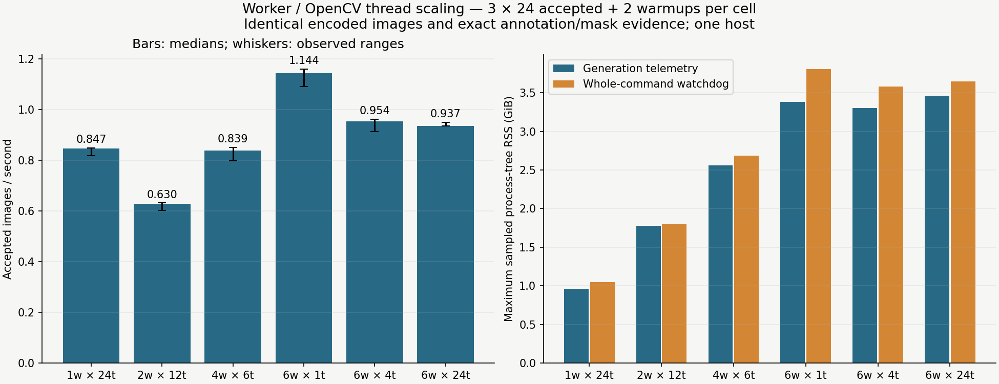
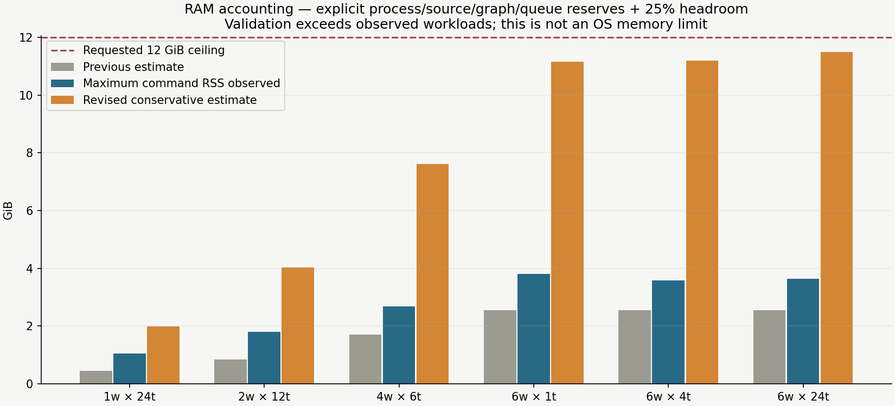

# Worker/thread scaling and RAM accounting

The requested6-worker ×24-thread stress test completed under a lower host-appropriate watchdog.
For this workload, **six workers with one OpenCV thread each were faster**. Increasing both worker and
native-thread counts did not produce monotonic scaling. This is one Linux environment, not a generic
hardware-class profile; all renderer/profile defaults remain unchanged.

[Offline report](index.html) · [Per-repeat measurements and memory components](summary.json)

| Workers × OpenCV threads each | Median accepted images/s (observed range) | Max sampled whole-command RSS GiB | Previous → revised estimate GiB |
| --- | ---: | ---: | ---: |
| 1 × 24 | 0.847 (0.819–0.850) | 1.05 | 0.45 → 1.98 |
| 2 × 12 | 0.630 (0.602–0.632) | 1.80 | 0.85 → 4.03 |
| 4 × 6 | 0.839 (0.800–0.852) | 2.69 | 1.70 → 7.61 |
| 6 × 1 | 1.144 (1.091–1.160) | 3.81 | 2.55 → 11.15 |
| 6 × 4 | 0.954 (0.913–0.962) | 3.58 | 2.55 → 11.20 |
| 6 × 24 | 0.937 (0.937–0.950) | 3.64 | 2.55 → 11.49 |

The6×1 median is about35% above1×24 and22% above6×24 here. Whole-command and generation-only memory
measurements differ: the former includes preparation, separate warmup pools and retained coordinator
allocations. The revised estimator exceeds every observed case; its deliberately conservative
worst-case reserves are not a prediction of typical RSS. The6×24 estimate is about11.49 GiB against
3.64 GiB observed, below the requested12 GiB planning ceiling. A normal RAM budget is advisory, not an
OS allocation limit. That estimate would still warn if currently available RAM were lower.





## Protocol and observations

The six-image ramp tests1×24,2×1,4×1,6×1,6×4 and6×24 with one warmup each. It is a low-sample screen;
brief local test activity overlapped the end of the ramp, so no performance recommendation uses it.
The repeated study then runs1×24,2×12,4×6,6×1,6×4 and6×24 sequentially in three rotating-order
repetitions. Each cell has24 accepted1280² heavy landing-pad images, the standard background mixture,
two warmups in a separate pool, no decoded cache and four QA renders. Window size equals workers for
multiprocessing; serial uses window2. Twenty-four fills batches evenly for2/4/6 workers. All cases
accepted24 images in25 attempts. Repetitions reuse the same deterministic scenes, measuring execution
variation rather than72 independent scenes. Generation throughput includes its own pool startup and
excludes preparation/separate warmup; command time includes both. Ranges are observed minima/maxima,
not confidence intervals.

The immutable measured renderer is `31dca0e2f20e845ee65e8ef69fc18dbc36f61120`. Every case passes pool
inspection and matches exact encoded images plus geometry/annotation/mask signatures. Revised
estimates are recalculated afterward from the same policies using the new shape model, whose source
hashes are retained. The measurement driver predates its final descendant-cleanup hardening; no guard
fired during either successful study. No timing code changed the renderer.

All runs requested `ram_budget_mb: 12288` (12 GiB), while the experimental watchdog used4.5 GiB summed
process-tree RSS,1.5 GiB minimum available RAM,64 MiB additional global swap-out and180 seconds per
cell. The host initially had about6 GiB available with existing swap nearly full, so consuming12 GiB
would have been inappropriate. Minimum available host memory during repeated tests was3.00 GiB;
observed total additional swap-out across cells was about1.53 MiB, below every cell's abort threshold.
The watchdog polls at0.25 seconds and can miss spikes. It stops its benchmark session/descendants and
preserves partial raw evidence on abort; it is not a hard OS memory limit.

Requested threads and actual OS threads differ. Recorded whole-command peaks were94 for serial1×24,
71 for2×12/4×6/6×1/6×4 and79 for6×24. These include other native-library/helper pools and are sampled
observations, not active compute counts or proof that all requested OpenCV threads execute. This
study does not establish whether bandwidth, backend parallelism, process scheduling or batch
stragglers explains the ranking. It shows which requested policies completed faster here.

## Memory model changes

The old auto planner selected workers before adding queued-result memory and could estimate a total
above its own RAM budget. It also omitted interpreter/coordinator overhead and used output size as a
proxy for source dimensions. Regression tests reproduce the old over-budget selection.

The new versioned component breakdown includes256 MiB runtime reserve per process,2 MiB per extra
requested/effective OpenCV thread, source headers and worst cover-resize expansion, declared graph
outputs plus operator scratch, instance masks, coordinator QA, serialization/receipt copies, total
cache payload and25% headroom. Header cache entries invalidate by file size/mtime; missing dimensions
produce an explicit uncertainty warning. These are transparent heuristic reserves, not measured hard
limits or coefficients fitted to this host. Unknown native/effect behavior can still exceed them.

Automatic selection evaluates the complete estimate for each candidate and respects explicit queue
capacity. If even one worker cannot fit, it retains one worker with a clear warning. Explicit workers
are not silently reduced. More cautious auto choices are intentional; shipped worker/thread/cache
settings and rendering remain unchanged. The estimate's conservatism can be refined with broader
workloads and #28's additional hardware environments, without teaching the planner this host's fastest
policy.

## Reproduce

Keep local composers/matrices in ignored `configs/local/` and raw results under ignored `outputs/`.
Use the shipped `examples/configs/landing-pad_minimal.yaml` with reporting.qa_samples=4 and execution
workers/native_threads/window/cache=1/1/2/0. Matrix format is strict:

```yaml
schema_version: 1
variants:
  one24: {workers: 1, native_threads: 24, max_in_flight: 2, decoded_cache_mb: 0, ram_budget_mb: 12288}
  two12: {workers: 2, native_threads: 12, max_in_flight: 2, decoded_cache_mb: 0, ram_budget_mb: 12288}
  four6: {workers: 4, native_threads: 6, max_in_flight: 4, decoded_cache_mb: 0, ram_budget_mb: 12288}
  six1: {workers: 6, native_threads: 1, max_in_flight: 6, decoded_cache_mb: 0, ram_budget_mb: 12288}
  six4: {workers: 6, native_threads: 4, max_in_flight: 6, decoded_cache_mb: 0, ram_budget_mb: 12288}
  six24: {workers: 6, native_threads: 24, max_in_flight: 6, decoded_cache_mb: 0, ram_budget_mb: 12288}
```

```sh
git worktree add --detach .worktrees/scaling-baseline 31dca0e2f20e845ee65e8ef69fc18dbc36f61120
# Choose fresh output directories; lower limits to suit currently available RAM.
PYTHONPATH=src uv run python scripts/study_execution_controls.py \
  --source-root .worktrees/scaling-baseline \
  --config configs/local/worker-scaling/baseline.yaml \
  --matrix configs/local/worker-scaling/full.yaml \
  --samples 24 --warmups 2 --repeats 3 \
  --rss-limit-gib 4.5 --min-available-gib 1.5 --max-swap-out-mib 64 \
  --cell-timeout-seconds 180 --output-dir outputs/experiments/worker-scaling/full
# Reproduce the ramp separately with its stated matrix and6/1/1 protocol.
# Report authoring requires both full/ and ramp/; it runs only after timing finishes.
PYTHONPATH=src uv run --with 'matplotlib>=3.10,<3.11' python scripts/report_worker_scaling.py \
  outputs/experiments/worker-scaling --config configs/local/worker-scaling/baseline.yaml \
  --output-dir outputs/experiments/worker-scaling/report
```

## Validation and remaining boundary

265 deterministic tests passed, including budget/queue/source-dimension regressions and a watchdog test where a descendant ignores termination after the coordinator exits. An actual low-RSS-limit smoke aborted the isolated benchmark and retained its reason/evidence. Four budget/header/thread-accounting regressions failed before the fix. Platform and CLI checks accompany the PR. Charts and report links are validated before delivery; browser layout inspection remains unavailable under the existing local-file browser policy.

Continue with the existing planning boundary for approximate smoothing/fidelity or scheduler/transport
redesign. This study makes neither change. See `../../WORKER_SCALING.md` and `../../EXECUTION.md`.
